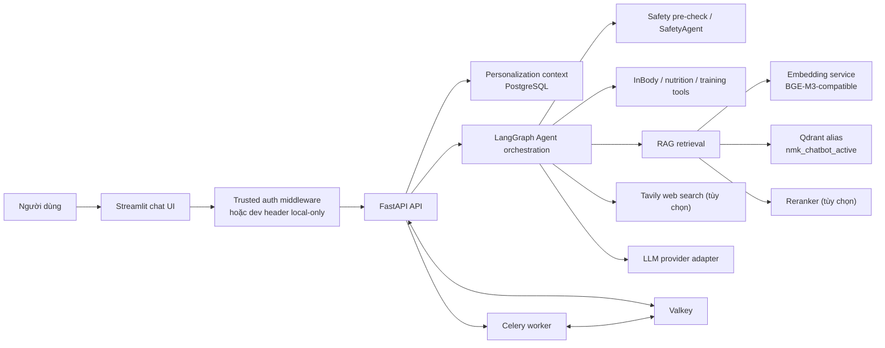
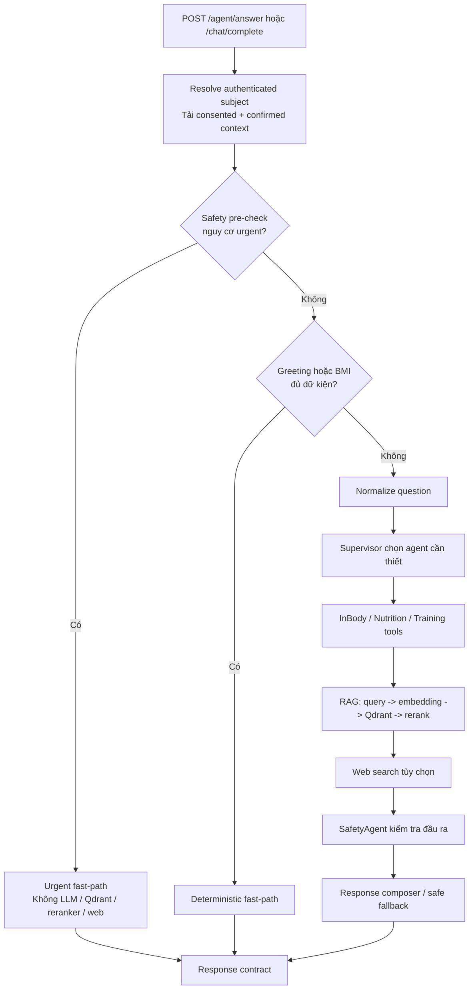
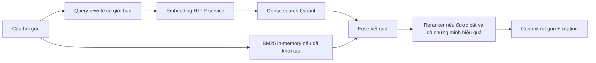
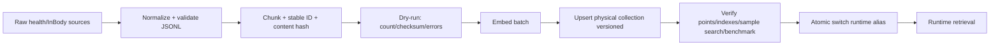
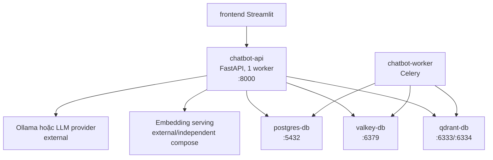

# Health/InBody Agentic RAG — Architecture

> **Trạng thái:** P0/P1 backend beta, chưa phải production-ready.
> **Phạm vi tài liệu:** kiến trúc đang có trong branch `multi-agent-rag-mvp` ngày 2026-08-15; phân biệt rõ phần đã chạy, giới hạn hiện tại và roadmap.

## 1. Mục tiêu

Health/InBody Agentic RAG là trợ lý tiếng Việt giúp người dùng hiểu chỉ số InBody, dinh dưỡng và tập luyện ở mức tham khảo. Hệ thống phải:

- trả lời dựa trên công cụ tính toán xác định và/hoặc nguồn kiến thức truy xuất được;
- ưu tiên an toàn y tế, không chẩn đoán hoặc kê đơn;
- hỗ trợ câu hỏi tổng hợp qua nhiều agent nhưng không gọi LLM/RAG khi một fast-path xác định đã đủ;
- có thể thay LLM và embedding provider qua cấu hình mà không đổi API contract hoặc Agent graph;
- nạp corpus Qdrant theo version, kiểm chứng trước rồi mới chuyển runtime bằng alias.

Hệ thống **không** phải bác sĩ, chuyên gia dinh dưỡng hoặc huấn luyện viên cá nhân. OCR/upload báo cáo InBody chưa được expose qua API MVP; dữ liệu chỉ số hiện được nhập dạng text hoặc qua endpoint profile/measurement.

## 2. Nguyên tắc kiến trúc

| Nguyên tắc | Quyết định áp dụng |
|---|---|
| Safety trước AI | Safety pre-check xác định chạy trước normalizer, router, Qdrant, reranker và web search. Case `urgent` trả ngay, không gọi dependency AI. |
| Model-agnostic | `LLM_PROVIDER`, model, timeout, token budget và embedding endpoint được đọc từ môi trường. Không có điều kiện theo tên model trong business logic. |
| Tool-first | BMI và các phép tính health có thể đi fast-path; không tốn LLM cho câu hỏi đã đủ dữ kiện. |
| Retrieval có bằng chứng | Context, source và citation phải map về tài liệu thật. Context yếu phải được báo là thiếu dữ liệu. |
| Data migration an toàn | Qdrant dùng physical collection có version + alias ổn định. Không ghi đè collection đang phục vụ. |
| Idempotent import | Point ID ổn định, content hash và manifest cho phép chạy lại/resume mà không nhân bản dữ liệu. |
| Degrade có chủ đích | Lỗi LLM/retrieval không được làm mất safety warning; response báo `degraded` cùng nguyên nhân. |
| Bảo mật dữ liệu sức khỏe | `/me` và chat lấy subject từ auth dependency; không dùng body/path `user_id` làm ownership. Chỉ dữ liệu consented, confirmed và chưa soft-delete được đưa vào Agent. |

## 3. Tổng quan hệ thống



Hệ thống có ba luồng chính:

1. **Request plane:** nhận chat, kiểm tra safety, chạy tool/agent/RAG, tổng hợp response.
2. **Knowledge plane:** chuẩn hóa tài liệu, chunk, embed, import collection version mới và chuyển alias sau validation.
3. **State & job plane:** PostgreSQL lưu profile/measurement, Valkey và Celery xử lý chat bất đồng bộ hoặc công việc nền.

## 4. Luồng request Agentic RAG

### 4.1 Luồng chuẩn



Entrypoint hiện tại là `agents.graph.multi_agent_handle`. Graph LangGraph có các node: `normalize_question`, `supervisor`, `inbody_agent`, `nutrition_agent`, `training_agent`, `rag_agent`, `web_search_agent`, `general_chat_agent`, `safety_agent` và `response_composer`.

Các node được nối tuần tự trong graph, nhưng agent chuyên trách tự bỏ qua khi supervisor không chọn chúng. Khi LangGraph không khả dụng, hệ thống dùng sequential fallback có cùng thứ tự node; đây là degraded mode, không phải một kiến trúc agent song song.

### 4.2 Safety contract

| Mức rủi ro | Hành vi |
|---|---|
| `urgent` | Dừng flow, trả hướng dẫn khẩn cấp, không gọi LLM/RAG/web. |
| `medical_caution` | Giữ cảnh báo, hạn chế lời khuyên y khoa, khuyến nghị gặp chuyên gia. |
| `low` | Tiếp tục flow bình thường nhưng composer vẫn phải giữ disclaimer phù hợp. |

Safety rule là deterministic trước; LLM không được phép xóa hoặc làm nhẹ cảnh báo do safety tool tạo ra.

### 4.3 Response contract

Agent trả payload có cấu trúc theo tinh thần sau:

```json
{
  "role": "assistant",
  "content": "...",
  "status": "ok | degraded",
  "fast_path": null,
  "selected_agents": [],
  "agent_trace": [],
  "tool_results": [],
  "retrieved_docs": [],
  "evidence_status": "supported | partial | insufficient | not_required",
  "evidence": [],
  "limitations": [],
  "safety_result": {},
  "personalization_used": {"available": false, "reason": "...", "provenance": []},
  "errors": []
}
```

`evidence` là citation do backend gán từ document đã retrieval, không phải ID do LLM tự tạo. `supported`/`partial` phải có evidence hợp lệ; RAG không tìm được context phải trả `insufficient`; tool, greeting và urgent fast-path dùng `not_required`. Composer chỉ được dùng citation có trong danh sách này; citation số không hợp lệ bị loại trước response.

`status=degraded` là tín hiệu dependency hoặc graph gặp lỗi; không được trả HTTP 200 chỉ với field `error` cho input/dependency lỗi. API layer cần duy trì lỗi input là 4xx, dependency lỗi là 502/503 hoặc timeout 504 khi phù hợp.

## 5. Thành phần và trách nhiệm

| Thành phần | Vị trí | Trách nhiệm | Trạng thái |
|---|---|---|---|
| API | `backend/src/api/app.py` | FastAPI endpoints, validation, sync/async chat, health/tool/user APIs. | Có |
| Auth boundary | `backend/src/auth/` | Resolve server-owned identity; dev header chỉ khi bật explicit; khóa legacy path-user API. | Có contract; production middleware ngoài app chưa nối |
| Agent orchestration | `backend/src/agents/` | LangGraph state, routing, fast-path, agent trace, composition. | Có |
| Health tools | `backend/src/health/` | BMI, PBF, mỡ nội tạng, nutrition, training và safety rule. | Có |
| RAG | `backend/src/rag/` | Query rewrite, dense search, BM25 process-local, rerank, metadata/chunking. | Có, còn giới hạn |
| Qdrant adapter | `backend/src/rag/qdrant/` | Collection, payload index, vector search, alias blue/green. | Có |
| LLM adapter | `backend/src/llm/client.py` | Ollama, OpenAI hoặc custom API và task budget riêng. | Có |
| Embedding adapter | `backend/src/llm/embedding.py` | Gọi embedding HTTP service. | Có |
| Embedding serving | `embed_serving/` | BGE-M3 REST API, CPU mặc định, CUDA/FP16 qua compose override. | Có |
| Persistence | `backend/src/persistence/`, `database/` | Owner-scoped profile, goal, measurement, progress, plan, check-in và confirmed-only context qua PostgreSQL. | Có P1 |
| Queue/cache | `backend/src/jobs/`, Valkey, Celery | Chat async/background task và cache/queue. | Có |
| Frontend | `frontend/` | Streamlit chat interface. | Có |
| OCR/upload InBody | roadmap P2 | Parse ảnh/PDF và confirmation flow. | Chưa triển khai runtime |

## 6. LLM và embedding: provider contract

### 6.1 LLM

LLM là dependency có thể thay đổi, không phải một tên model cố định. Adapter hiện hỗ trợ:

- `LLM_PROVIDER=ollama` với `OLLAMA_BASE_URL`, `OLLAMA_MODEL`, `OLLAMA_THINK`;
- `LLM_PROVIDER=openai` với `OPENAI_API_KEY`, `OPENAI_MODEL`;
- `LLM_PROVIDER=custom` hoặc `vietnamese_llm` với endpoint custom;
- `LLM_PROVIDER=none` để chạy tool/fallback không sinh ngôn ngữ.

Mỗi tác vụ có budget riêng (router, normalize, rewrite, composer), do đó việc đổi model phải benchmark lại timeout/token budget thay vì đổi code theo model. `OLLAMA_THINK=auto` phải bỏ field đặc thù khỏi request, không đoán capability từ tên model.

### 6.2 Embedding

Backend gọi `CUSTOM_EMBEDDING_API_URL` tới service HTTP. Service hiện được thiết kế cho BGE-M3, vector size 1024, và expose:

- `GET /health` — device, model state và embedding dimension;
- `POST /embed` — embed một hoặc nhiều text;
- `POST /similarity` — cosine similarity.

`embed_serving` chạy CPU/float32 mặc định. CUDA/float16 là override có điều kiện: chỉ bật sau khi health/runtime chứng minh CUDA thực sự hoạt động, đồng thời không giả định GPU 4 GB có thể chứa LLM lớn và BGE-M3 cùng lúc. Import bulk nên benchmark chế độ ưu tiên GPU cho embedding; online serving cần benchmark riêng.

## 7. Retrieval và nguồn trích dẫn

### 7.1 Retrieval flow



Query gốc phải là retrieval query đầu tiên. Không mở rộng ba query mặc định cho mọi request. Với medical safety query, retrieval cần filter/boost `medical_safety` và loại recipe không liên quan.

### 7.2 Giới hạn hiện tại cần nói thật

Mã có dense search Qdrant và BM25. P0 đã thêm snapshot BM25 versioned trên disk và autoload khi API startup; index chạy trong RAM sau khi load. Vì vậy:

- chỉ được gọi là hybrid khi snapshot load thành công và stats chứng minh BM25 coverage;
- nhiều Uvicorn worker vẫn nhân bản index RAM, nên runtime hiện khóa `API_WORKERS=1`;
- benchmark phải ghi rõ dense-only hay có BM25 thật sự tham gia;
- hướng mở rộng là sparse vector trong Qdrant hoặc sparse storage dùng chung khi cần scale nhiều worker.

Safety/caution retrieval hiện truyền filter `content_type=medical_safety` cho cả dense search lẫn BM25. Đây là guardrail giảm nguy cơ recipe/nutrition chen vào context y tế; nó không thay thế corpus safety đủ rộng hoặc benchmark retrieval.

Citation chỉ hợp lệ nếu `source`/document trong response thực sự thuộc context truy xuất. Khi không có evidence đủ mạnh, composer phải nêu giới hạn thay vì suy diễn.

## 8. Dữ liệu, metadata và Qdrant blue/green

### 8.1 Data lifecycle



Mỗi chunk cần tối thiểu các metadata có thể kiểm tra: `document_id`/`doc_id`, `content`, `source`, `content_type`, `domain`, `language`, `corpus_version`, `content_hash` và stable point ID. Payload indexes được tạo cho các field phục vụ filter/audit như content type, document id, corpus version, hash, source, language và metadata review.

### 8.2 Alias và version

Runtime phải đọc alias ổn định `nmk_chatbot_active`, không buộc vào tên collection vật lý. Baseline tài liệu hiện có mô tả:

| Mục | Giá trị baseline |
|---|---|
| Physical collection mới | `nmk_chatbot_collection_v20260730_bge_m3_1024` |
| Runtime alias | `nmk_chatbot_active` |
| Corpus version | `2026-07-30-v2` |
| Vector size | 1024 |
| Point dự kiến | 23.608 |

Các giá trị này là mốc import, **không phải bằng chứng collection runtime hiện tại đang healthy**. Trước mỗi restart/migration phải chụp point count, alias target, job import/manifest cuối và Qdrant queue status.

### 8.3 Import/recovery contract

1. Dry-run phải xác nhận schema, checksum, số document/chunk và không có validation error.
2. Import thật ghi manifest, corpus version, batch config và `last_successful_upsert_line`.
3. Lỗi hạ tầng chỉ resume từ dòng manifest xác nhận upsert thành công; không đoán offset.
4. Gate gồm point count, vector dimension, payload indexes, manifest, sample search và retrieval benchmark.
5. Chỉ sau gate mới đổi alias nguyên tử; không restart Qdrant để đổi collection.
6. Giữ collection cũ để rollback. Nếu collection cũ đã xóa, rollback yêu cầu backup hoặc import lại collection đã kiểm định.

## 9. Persistence, async job và phân tách trạng thái

| Dữ liệu/trạng thái | Nơi lưu | Lưu ý |
|---|---|---|
| Profile, goal, measurement, plan, check-in | PostgreSQL | Mọi query resource lọc theo authenticated owner; measurement delete là soft delete. |
| Personalization context | Tạo từ persistence | Cần cả health-data + personalization consent; chỉ measurement confirmed/non-deleted, active goal và field allowlist. |
| Queue/cache | Valkey | Không đưa health PII không cần thiết vào key/log/payload. |
| Chat/background work | Celery worker | API có thể gọi sync hoặc enqueue, client phải hiểu task status/polling. |
| Agent state | Request scope | Không đặt state bền vững trong global RAM; multi-worker sẽ không nhất quán. |
| BM25 hiện tại | RAM process | Là technical debt, không dùng làm source of truth. |

## 10. Deployment topology

`backend/docker-compose.yml` hiện khai báo các service sau:



- `chatbot-api` chạy `uvicorn api.app:app` với `API_WORKERS=1` mặc định để BM25 RAM nhất quán.
- `chatbot-worker` chạy `celery -A jobs.tasks.celery_app worker`.
- Qdrant, PostgreSQL và Valkey có volume Docker riêng.
- Embedding serving là compose độc lập; endpoint backend mặc định dùng `host.docker.internal:5001`, hoặc service name khi đưa vào cùng network.
- LLM/Ollama cũng là dependency bên ngoài compose backend theo `.env`.

Trước deploy, chạy `docker compose ... config`; trước restart khi bulk import, xác minh job và collection. Sau deploy, test HTTP thật, không dùng TestClient thay cho runtime validation.

## 11. API bề mặt chính

| Nhóm | Endpoint tiêu biểu | Mục đích |
|---|---|---|
| Health | `GET /health` | Kiểm tra API/dependency runtime. |
| Agent/chat | `POST /agent/answer`, `POST /chat/complete`, `GET /chat/complete/{task_id}` | Trả lời trực tiếp hoặc qua task async. |
| Retrieval | `POST /search` | Search độc lập để debug/evaluation. |
| Tools | `POST /tools/bmi`, `/pbf`, `/visceral-fat`, `/nutrition`, `/training`, `/safety` | Tool deterministic và safety. |
| Personalization P1 | `/me/profile`, `/me/goals/*`, `/me/measurements/*`, `/me/progress/*`, `/me/plans/*`, `/me/check-ins` | Owner-scoped profile, mục tiêu, lịch sử đo, progress, plan và check-in. |
| Legacy user API | `/users/{user_id}/*` | Mặc định 404; chỉ bật local khi `AUTH_MODE=development`, flag legacy=true và path user khớp auth subject. |
| Data admin | `/collection/create`, `/document/create`, `/documents/index`, `/data/import` | Chỉ mở cho vận hành đã có authentication/authorization. |

Các endpoint write/admin đang là bề mặt rủi ro khi production chưa có auth/authz và rate limit. Không nên expose công khai chỉ vì chúng tiện dùng trong demo.

## 12. Observability, quality gates và an toàn

### 12.1 Dữ liệu cần ghi theo request/release

- request ID, route, agent trace, `fast_path`, status, latency P50/P95 theo route;
- provider/model **không secret**, timeout, corpus/collection version, embedding device/dtype/batch;
- retrieval evidence IDs và citation support rate;
- safety classification, nhưng không log nội dung PII/health metric đầy đủ trừ khi có chính sách phù hợp;
- import manifest, checksum, point count và error count.

### 12.2 Gate tối thiểu trước khi gọi beta đủ tin cậy

| Nhóm | Gate |
|---|---|
| Safety | Urgent không gọi LLM/RAG/web; safety retrieval không trả recipe trong top 5. |
| Fast-path | BMI/tool-only có regression test chứng minh không gọi LLM/search. |
| RAG | Router accuracy >= 95%, Recall@5 >= 90%, strict top-1 >= 75%, citation precision >= 95% — chỉ công bố sau eval set versioned. |
| Runtime | Request chuẩn không vượt budget; urgent/tool P95 được đo trên HTTP thật. |
| Privacy | Không cross-user access; auth/authz và rate limit hoạt động trước production candidate. |
| Operations | Soak test không OOM/restart; migration/rollback được diễn tập. |

Các phần trăm trên là mục tiêu nghiệm thu, không phải kết quả đã đạt. Smoke test nhỏ không chứng minh accuracy tổng quát; corpus có thể thiên về nutrition so với safety/InBody, nên retrieval theo từng content type phải được đo riêng.

## 13. Cấu trúc mã nguồn hiện tại

```text
Health-InBody-Agent-RAG/
├── backend/
│   ├── src/
│   │   ├── api/             # FastAPI app, route/schema
│   │   ├── agents/          # LangGraph graph, state, parsing
│   │   ├── core/            # config, cache, utilities
│   │   ├── health/          # deterministic health + safety tools
│   │   ├── integrations/    # Tavily adapter
│   │   ├── jobs/            # Celery tasks
│   │   ├── llm/             # LLM and embedding adapters
│   │   ├── persistence/     # database, models, personalization
│   │   ├── pipelines/       # import/reuse vector jobs
│   │   └── rag/             # search, rerank, splitter, Qdrant adapter
│   ├── tests/{unit,integration}/
│   ├── docker-compose.yml
│   └── .env.example
├── embed_serving/           # BGE-M3 serving and CPU/GPU compose
├── frontend/                # Streamlit UI
├── data_pipeline/           # prepare/merge/build embedding dataset
├── database/                # PostgreSQL init schema
└── docs/                    # import, embedding, roadmap, evaluation docs
```

## 14. Ưu tiên triển khai tiếp theo

1. **P0 trust RAG/safety:** fixture evaluation versioned, citation contract, safety regression và latency HTTP measurement.
2. **Hoàn thiện retrieval:** persist/shared sparse index hoặc sparse vector; không tiếp tục gọi hệ thống hybrid đầy đủ trước khi xong.
3. **P1 personalization backend:** đã triển khai auth boundary, ownership, consent, confirmation, progress, plan/check-in versioning và migration; UI P1 còn là follow-up.
4. **P2 OCR/privacy/live web:** upload/OCR confidence, account export/delete và purge retention, web search không gửi PII và không tự ingest.
5. **Production candidate:** rate limit, audit log, metrics/alerts, backup/restore Qdrant/PostgreSQL, soak/load test và rollout/rollback runbook.

## 15. Các rủi ro và giả định còn mở

| Rủi ro/giả định | Tác động | Quyết định cần có |
|---|---|---|
| Corpus 23.608 points đã từng import không đồng nghĩa runtime alias đang trỏ đúng collection. | Có thể trả lời từ corpus cũ/rỗng. | Check alias, stats, manifest và sample search qua HTTP trước demo. |
| BM25 process-local. | Kết quả khác giữa worker/restart; claim hybrid sai. | Chọn persistent sparse architecture và migration plan. |
| 2 Uvicorn workers + global RAM. | Cache/index state không chia sẻ. | Chỉ dùng RAM cho cache tái tạo được; state bền vững phải chuyển shared storage. |
| GPU 4 GB. | Dễ OOM khi LLM lớn và BGE-M3 dùng chung VRAM. | Benchmark theo mode bulk/online và đặt admission policy. |
| Production auth middleware chưa được nối vào `request.state.current_user`. | Standalone production mode chặn `/me`/chat bằng 401; không thể mở public. | Tích hợp IdP/JWT hoặc trusted middleware, chạy lại ownership suite; tuyệt đối không bật dev header production. |
| Web search. | Có thể lộ PII hoặc tạo claim không kiểm chứng. | Opt-in, redaction, allowlist/attribution và không tự ingest. |
| LLM thay model/provider. | Chất lượng, latency và output format đổi. | Chạy regression/eval/release report cho từng cấu hình model. |

## 16. Tài liệu liên quan

- `README.md` — phạm vi và luồng MVP tổng quan.
- `backend/README.md` — backend/API và runtime variables.
- `docs/QDRANT_BLUE_GREEN_IMPORT.md` — runbook import/alias/rollback.
- `docs/implementation-roadmap/` — P0/P1/P2 và evaluation/acceptance.
- `docs/P0_TRUST_RAG_SAFETY_REPORT_2026-08-14.md` — báo cáo nghiệm thu P0 (safety, fast-path, hybrid retrieval).
- `docs/P1_PERSONALIZATION_REPORT.md` — báo cáo nghiệm thu P1 (personalization, progress tracking, data safety).

---

**Quy tắc vận hành chốt:** một sửa đổi chỉ được gọi là “đã chạy” khi source, container/runtime và HTTP smoke test đều được xác minh; một collection chỉ được gọi là “sẵn sàng” sau khi hoàn tất manifest, count/index, retrieval evaluation và alias verification.
