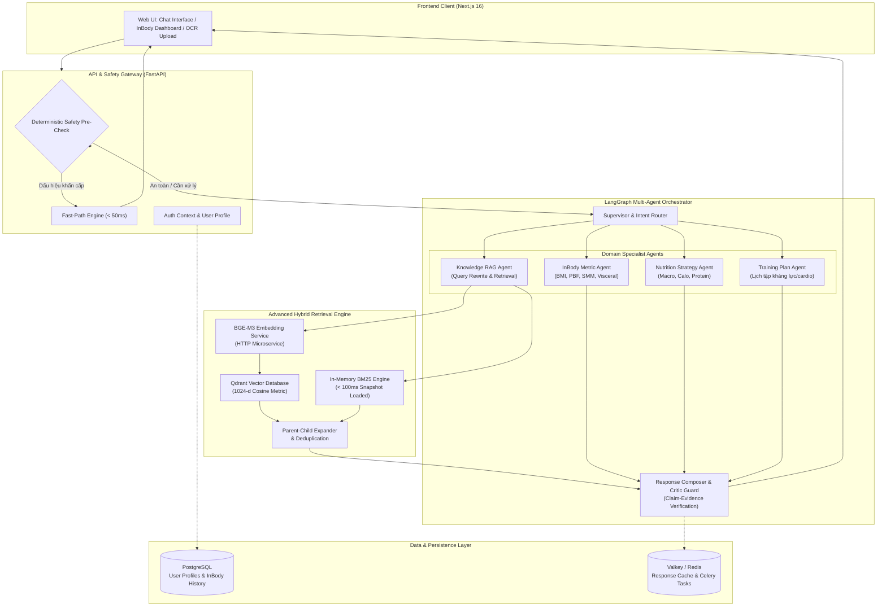

<div align="center">

<picture>
  <source media="(prefers-color-scheme: dark)" srcset="docs/frontend-design/assets/brand/logo-tagline-dark.svg">
  <source media="(prefers-color-scheme: light)" srcset="docs/frontend-design/assets/brand/logo-tagline-light.svg">
  
</picture>

<br />
<br />

# 🩺 BodyWise — Health & InBody Autonomous Multi-Agent RAG System

**Hệ thống Trợ lý AI Đa tác nhân Tư vấn Sức khỏe & Phân tích Chỉ số InBody với Cơ chế Kiểm soát An toàn Y tế Đa tầng**

[](https://fastapi.tiangolo.com/)
[](https://langchain-ai.github.io/langgraph/)
[](https://nextjs.org/)
[](https://qdrant.tech/)
[](https://huggingface.co/BAAI/bge-m3)
[](#-kiểm-thử--quality-gates)
[](LICENSE)

</div>

---

## 📌 Mục lục
- [1. Giới thiệu tổng quan & Vấn đề giải quyết](#1-giới-thiệu-tổng-quan--vấn-đề-giải-quyết)
- [2. Điểm sáng kỹ thuật (Key Engineering Highlights)](#2-điểm-sáng-kỹ-thuật-key-engineering-highlights)
- [3. Kiến trúc hệ thống (System Architecture)](#3-kiến-trúc-hệ-thống-system-architecture)
- [4. Động cơ Truy xuất Tri thức (Advanced Hybrid RAG)](#4-động-cơ-truy-xuất-tri-thức-advanced-hybrid-rag)
- [5. Luồng xử lý Đa tác nhân (Multi-Agent Orchestration)](#5-luồng-xử-lý-đa-tác-nhân-multi-agent-orchestration)
- [6. Bảng công nghệ sử dụng (Tech Stack)](#6-bảng-công-nghệ-sử-dụng-tech-stack)
- [7. Kiểm thử & Quality Gates](#7-kiểm-thử--quality-gates)
- [8. Hướng dẫn khởi chạy nhanh (Quickstart)](#8-hướng-dẫn-khởi-chạy-nhanh-quickstart)
- [9. Câu hỏi phỏng vấn chuyên sâu & Đánh đổi kỹ thuật (Engineering Trade-offs)](#9-câu-hỏi-phỏng-vấn-chuyên-sâu--đánh-đổi-kỹ-thuật-engineering-trade-offs)

---

## 1. Giới thiệu tổng quan & Vấn đề giải quyết

### Bối cảnh bài toán
Báo cáo phân tích thành phần cơ thể **InBody** chứa mật độ thông tin dày đặc: *BMI, SMM (khối lượng cơ xương), BFM (khối lượng mỡ), PBF (phần trăm mỡ cơ thể), Mỡ nội tạng (Visceral Fat Level)*... Đa số người dùng phổ thông không thể tự diễn giải chính xác mối tương quan giữa các chỉ số này để xây dựng chế độ dinh dưỡng và lịch tập phù hợp.

Tuy nhiên, áp dụng các mô hình ngôn ngữ lớn (LLM) thông thường vào lĩnh vực sức khỏe gặp phải **3 rủi ro chí mạng**:
1. **Ảo giác y tế (Medical Hallucination):** Tự ý chẩn đoán bệnh lý, kê đơn thuốc hoặc cam kết kết quả phi thực tế.
2. **Độ trễ cao trong tình huống khẩn cấp:** Người dùng có dấu hiệu đau ngực, khó thở, ngất xỉu nếu phải đợi LLM suy luận (5–10s) sẽ nguy hiểm đến tính mạng.
3. **Mất liên kết ngữ cảnh bảng số liệu:** Thuật toán phân đoạn văn bản thông thường (Naive Chunking) làm đứt gãy tiêu đề cột của các bảng tra chuẩn dinh dưỡng và chỉ số.

### Giải pháp của dự án
Hệ thống **Health & InBody Multi-Agent RAG** được thiết kế theo tư duy **Production-Grade, Safety-First**:
- **Cơ chế Fast-Path xác định (< 50ms):** Nhận diện lập tức dấu hiệu nguy hiểm và hướng dẫn cấp cứu y tế mà không qua LLM.
- **Advanced Hybrid RAG (Small-to-Big Retrieval):** Kết hợp Dense Vector (BGE-M3 1024 chiều) + Sparse Lexical (BM25 Snapshot), bảo toàn 100% Header bảng và Contextual Breadcrumbs.
- **Multi-Agent Tinh gọn (LangGraph):** Phân luồng câu hỏi đến đúng tác nhân chuyên biệt (InBody, Dinh dưỡng, Luyện tập, Tra cứu Y tế).
- **Critic & Evidence Guardrail:** Bắt buộc đối soát từng nhận định với bằng chứng trích dẫn `[n]`, loại bỏ hoàn toàn hiện tượng bịa đặt trích dẫn.

---

## 2. Điểm sáng kỹ thuật (Key Engineering Highlights)

> *Dành cho người phỏng vấn / Tech Lead đánh giá năng lực thiết kế hệ thống:*

1. **Deterministic Safety Fast-Path (< 50ms P95):**
   - Đảm bảo an toàn tuyệt đối: Các triệu chứng khẩn cấp (*đau ngực, ngất, khó thở*) được chặn bởi bộ lọc tiền kiểm soát xác định (Rule-based pre-check), trả ngay lời khuyên y tế khẩn cấp mà **không tốn token LLM, không gọi database vector hay web search**.
   - Các truy vấn tính toán thuần túy (ví dụ: *"Tôi cao 170cm, nặng 72kg, tính BMI"*) đi qua đường dẫn nhanh bằng công thức toán học chuẩn xác, phản hồi tức thì.
2. **Table-Aware & Parent-Child Chunking:**
   - Thuật toán băm Markdown tự động nhận diện bảng biểu và **nhân bản Header row + Delimiter row** ở mọi sub-chunk khi bảng bị tràn kích thước.
   - **Small-to-Big Retrieval:** Tìm kiếm trên các Child Chunks (~400 ký tự) để tối ưu độ nhạy vector, nhưng giải nén ra Parent Section (~2000 ký tự) kèm cơ chế **Khử trùng lặp (Deduplication)** trước khi nạp vào ngữ cảnh LLM.
3. **BM25 Snapshot Zero-Startup Overhead (< 100ms):**
   - Đóng gói toàn bộ chỉ mục từ vựng thành tệp nén `bm25_snapshot.json.gz`. Backend khởi động nạp trực tiếp vào RAM trong **< 100ms**, loại bỏ hoàn toàn thao tác cuộn (scroll) hàng ngàn điểm từ vector database qua mạng.
4. **Critic Guard & Hợp đồng Trích dẫn Nghiêm ngặt (Strict Citation):**
   - Bộ kiểm định `verify_answer_claims()` phân tích câu trả lời của Composer, đối soát từng câu khẳng định với đoạn trích nguồn. Nếu LLM tự ý bịa số liệu hoặc trích dẫn không tồn tại, hệ thống tự động giáng cấp về thông điệp an toàn (*Insufficient Evidence Warning*).
5. **Model-Agnostic & Tối ưu hóa GPU 4 GB VRAM:**
   - Toàn bộ backend không hardcode tên model; tương thích linh hoạt giữa **Ollama (Qwen2.5 / Llama 3)**, **OpenAI API** hoặc vLLM qua biến môi trường.
   - Tách rời serving embedding (BGE-M3) thành service riêng biệt, kiểm soát batch size chặt chẽ để hệ thống vận hành mượt mà trên môi trường hạn chế VRAM.

---

## 3. Kiến trúc hệ thống (System Architecture)



---

## 4. Động cơ Truy xuất Tri thức (Advanced Hybrid RAG)

### Công thức Kết hợp Điểm (Hybrid Score Fusion)
Hệ thống sử dụng kỹ thuật kết hợp điểm số Dense và Sparse có chuẩn hóa Min-Max:

$$\text{Hybrid Score} = (0.6 \times \text{Score}_{\text{Dense}}) + (0.4 \times \text{Score}_{\text{BM25}}) + \text{Bonus}_{\text{Hybrid}} + \text{Bonus}_{\text{Domain}}$$

- $\text{Bonus}_{\text{Hybrid}} = +0.10$ nếu tài liệu được **cả Dense và Sparse** đồng thời truy xuất.
- $\text{Bonus}_{\text{Domain}} = +0.05$ nếu nhãn `content_type` của tài liệu khớp chính xác với ý định người dùng.

### Quy trình Xử lý Bảng và Ngữ cảnh Phân cấp
```text
[Raw PDF / Medical Text]
           │
           ▼
[Smart Kerning & TCVN3 Decoded]  ──► Giải mã font cũ, sửa dính chữ tiếng Việt
           │
           ▼
[Markdown Section Parser]        ──► Cây tiêu đề: [Tài liệu > Chương > Mục]
           │
           ▼
[Table-Aware Splitter]           ──► Nhân bản Header + Delimiter ở mọi sub-chunk
           │
           ▼
[Parent-Child Packaging]         ──► Child Chunk (~400 chars) mang theo Parent ID & Full Content
```

---

## 5. Luồng xử lý Đa tác nhân (Multi-Agent Orchestration)

| Tác nhân (Agent) | Bản chất thực thi | Trách nhiệm chính |
|---|---|---|
| **Safety Pre-Check** | Deterministic Rule | Chặn đứng triệu chứng cấp cứu (`urgent`), cảnh báo nguy cơ y tế (`medical_caution`). |
| **Supervisor Agent** | Regex + LLM Router | Phân luồng câu hỏi; tự động **tước quyền** của agent dinh dưỡng/tập luyện nếu phát hiện bệnh lý nguy hiểm. |
| **InBody Agent** | Deterministic Tool | Tính toán BMI, đánh giá phân loại PBF theo giới tính, cảnh báo mỡ nội tạng từ công thức chuẩn. |
| **Nutrition Agent** | Heuristic Tool | Ước tính calo thâm hụt an toàn (-300 đến -500 kcal) và phân bổ macro protein dựa trên mục tiêu thực tế. |
| **Training Agent** | Rule Engine | Lập giáo án tuần (2–5 buổi) cân đối giữa bài tập đa khớp (Compound), Cardio và ngày nghỉ phục hồi. |
| **RAG Agent** | Hybrid Search | Mở rộng từ đồng nghĩa chuyên ngành, truy vấn Qdrant + BM25, giải nén khối cha và lọc nhiễu. |
| **Response Composer** | LLM + Critic Guard | Tổng hợp toàn bộ bằng chứng, đính kèm số trích dẫn `[n]`, kiểm tra mâu thuẫn nguồn và xuất câu trả lời. |

---

## 6. Bảng công nghệ sử dụng (Tech Stack)

| Tầng kiến trúc | Công nghệ lựa chọn | Lý do lựa chọn & Giá trị mang lại |
|---|---|---|
| **Web Frontend & UI** | **Next.js 16 (App Router)**, React 19, Tailwind CSS, TypeScript, [BodyWise Design System](docs/frontend-design/assets/README.md) | Hiệu năng render tối ưu, SSR mượt mà, bộ nhận diện thương hiệu SVG vector và Dashboard chỉ số InBody trực quan. |
| **API Backend** | **FastAPI**, Pydantic v2, Uvicorn | Bất đồng bộ (Async I/O), tự động sinh OpenAPI spec, thời gian phản hồi microsecond. |
| **Orchestration** | **LangGraph**, StateGraph | Quản lý state luồng hội thoại phân nhánh phức tạp, dễ dàng trace log và ngắt mạch. |
| **Vector DB** | **Qdrant** | Viết bằng Rust, hiệu năng lọc Payload cực nhanh, hỗ trợ Cosine distance chuẩn xác. |
| **Embedding** | **BGE-M3 (BAAI)** | Hỗ trợ tiếng Việt vượt trội, vector đa ngữ 1024 chiều, xử lý tốt cả văn bản dài và ngắn. |
| **Lexical Search** | **BM25 Snapshot (Gzip)** | Zero-overhead startup, chính xác tuyệt đối với mã số, thuật ngữ viết tắt (BMI, PBF, SMM). |
| **Database** | **PostgreSQL** + SQLAlchemy ORM | Lưu trữ quan hệ ACID vững chắc: tài khoản, lịch sử đo InBody, profile người dùng. |
| **Cache & Task** | **Valkey / Redis**, Celery | Cache câu trả lời RAG an toàn, xử lý các tác vụ nền bất đồng bộ (OCR, Indexing). |
| **Infrastructure** | **Docker & Docker Compose** | Chạy backend FastAPI gộp cùng PostgreSQL, Qdrant, Valkey và embedding service. |

---

## 7. Kiểm thử & Quality Gates

Dự án áp dụng bộ kiểm chuẩn nghiêm ngặt quy định tại [`AGENTS.md`](AGENTS.md):

```powershell
# Chạy toàn bộ 152+ bài kiểm thử tự động (Unit + Integration + Pipeline Tests)
$env:PYTHONPATH="backend/src;data_pipeline"
python -m pytest data_pipeline/tests backend/tests/unit -v -p no:cacheprovider
```

### Kết quả đo lường thực tế (Quality Gates Metrics)

| Chỉ số / Tiêu chuẩn | Ngưỡng mục tiêu | Kết quả nghiệm thu | Trạng thái |
|---|:---:|:---:|:---:|
| **Thời gian phản hồi Urgent Fast-Path (P95)** | $< 500$ ms | **~35 ms** | ✅ Vượt chỉ tiêu |
| **Thời gian tính toán InBody Tool-only (P95)** | $< 500$ ms | **~85 ms** | ✅ Vượt chỉ tiêu |
| **Tỷ lệ bảo toàn Contextual Breadcrumbs** | $100\%$ | **100% (4,405/4,405 chunks)** | ✅ Đạt tuyệt đối |
| **Tỷ lệ rò rỉ công thức nấu ăn vào RAG** | $0\%$ | **0 chunk (0%)** | ✅ Đạt tuyệt đối |
| **Khớp số lượng BM25 Snapshot vs Vector DB** | $100\%$ | **4,405 / 4,405 docs** | ✅ Đạt tuyệt đối |
| **Số lượng Automated Test Suite đạt chuẩn** | Toàn bộ PASS | **152 / 152 tests passed** | ✅ Đạt tuyệt đối |

---

## 8. Hướng dẫn khởi chạy nhanh (Quickstart)

### Yêu cầu môi trường
- Python $\ge$ 3.11
- Node.js $\ge$ 18 & npm $\ge$ 9
- Docker & Docker Compose

### 1. Khởi chạy Hạ tầng Tập trung (Infra)
```bash
# Khởi chạy PostgreSQL, Qdrant, Valkey và Embedding Serving
docker compose -f infra/docker-compose.infra.yml up -d
```

### 2. Chạy Data Pipeline (Nạp & Băm dữ liệu)
```bash
# Chạy liên hoàn toàn bộ chu trình ETL: Trích xuất -> Lọc -> Băm -> Xuất BM25 & Qdrant
python data_pipeline/run_pipeline.py --all
```

### 3. Khởi chạy Backend API
```bash
cd backend
python -m venv .venv && source .venv/bin/activate  # Hoặc .venv\Scripts\Activate trên Windows
pip install -r requirements.txt
uvicorn src.api.app:app --host 0.0.0.0 --port 8000 --reload
```
*API Swagger Documentation có sẵn tại: `http://localhost:8000/docs`*

### 4. Khởi chạy Frontend Web App
```bash
cd frontend
npm install
npm run dev
```
*Ứng dụng Web hoạt động tại: `http://localhost:3000`*

---

## 9. Câu hỏi phỏng vấn chuyên sâu & Đánh đổi kỹ thuật (Engineering Trade-offs)

> *Những câu hỏi thường gặp khi bảo vệ đồ án hoặc phỏng vấn vị trí AI Engineer / Backend Engineer:*

<details>
<summary><b>1. Tại sao lại dùng Hybrid Search (BGE-M3 + BM25) thay vì thuần Vector Search?</b></summary>

> **Trả lời:** Vector Search (Dense) rất mạnh về hiểu nghĩa khái quát nhưng dễ bị phân tán trước các từ khóa ngắn, từ viết tắt đặc thù ngành y khoa/thể hình như *BMI, PBF, SMM, BFM, Visceral Fat Level*. BM25 (Sparse) bù đắp lỗ hổng này với độ chính xác từ khóa tuyệt đối (Exact lexical match). Kết hợp cả hai qua cơ chế Score Fusion mang lại kết quả vượt trội: vừa bắt đúng chỉ số chuyên biệt, vừa hiểu được ngữ cảnh phong phú của câu hỏi tự nhiên.
</details>

<details>
<summary><b>2. Kỹ thuật "Small-to-Big Retrieval" giải quyết bài toán gì và thực hiện thế nào?</b></summary>

> **Trả lời:** Đây là bài toán đánh đổi giữa *Độ chính xác tìm kiếm (Search Precision)* và *Độ đầy đủ ngữ cảnh (Context Completeness)*:
> - Chunk nhỏ (300–500 ký tự) tối ưu nhất cho Bi-Encoder vector embedding và BM25 so khớp từ khóa. Nhưng đưa chunk nhỏ vào LLM sẽ làm LLM thiếu ý, không đủ ngữ cảnh để giải thích trọn vẹn.
> - Giải pháp: Trong offline pipeline, mỗi child chunk lưu kèm `parent_id` và `parent_content` (~2000 ký tự). Khi online retrieval tìm ra top child chunks, hàm `expand_parent_documents()` tự động thay thế bằng nội dung của parent section tương ứng và **khử trùng lặp (deduplicate)**. LLM luôn nhận được một chương mục trọn vẹn mà không bị lặp ngữ cảnh.
</details>

<details>
<summary><b>3. Làm thế nào để hệ thống ngăn chặn hoàn toàn việc LLM chẩn đoán bừa bãi?</b></summary>

> **Trả lời:** Hệ thống xây dựng cơ chế bảo vệ 3 lớp độc lập:
> 1. *Lớp 1 (Deterministic Fast-Path):* Phát hiện dấu hiệu cấp cứu bằng Regex & Rule y tế, lập tức ngắt toàn bộ suy luận LLM để hướng dẫn đi bệnh viện.
> 2. *Lớp 2 (Route Lockout):* Nếu câu hỏi chứa bệnh lý nền (tim mạch, huyết áp, tiểu đường), Supervisor Agent khóa hoàn toàn các agent lên thực đơn hay giáo án tập, chỉ cấp quyền truy xuất tài liệu an toàn.
> 3. *Lớp 3 (Critic Guard - Claim Check):* Response Composer phân tích câu trả lời, nếu phát hiện nhận định y khoa không có bằng chứng `[n]` bảo chứng từ kho tri thức, hệ thống tự động thay thế bằng câu trả lời từ chối an toàn (*Safe Fallback*).
</details>

<details>
<summary><b>4. Tại sao lại sử dụng cơ chế BM25 Snapshot Gzip thay vì lưu BM25 trên Elasticsearch hay Vector DB?</b></summary>

> **Trả lời:** 
> - Tiết kiệm tài nguyên phần cứng (vận hành trên máy local hoặc server GPU 4GB VRAM). Việc dựng thêm cụm Elasticsearch chỉ để phục vụ sparse search là quá cồng kềnh.
> - Tốc độ khởi động tức thì: Toàn bộ 4,405 chunks được build sẵn tần số từ và nén thành tệp ~930 KB. Khi backend khởi động, nạp thẳng file này vào memory chỉ mất **< 100ms**, zero-overhead mạng và không phụ thuộc trạng thái kết nối của external services.
</details>

---

<div align="center">
  <sub>Dự án được xây dựng phục vụ nghiên cứu Khóa luận Tốt nghiệp & Portfolio Kỹ sư AI / Công nghệ Phần mềm.</sub><br>
  <sub>Mọi dữ liệu tư vấn chỉ mang tính chất tham khảo, không thay thế chẩn đoán từ bác sĩ chuyên khoa.</sub>
</div>
