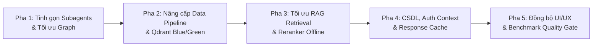

# KẾ HOẠCH NÂNG CẤP DỰ ÁN HEALTH/INBODY AGENT RAG (2026)

> **Mục tiêu:** Chuyển dịch hệ thống từ trạng thái **MVP / RAG Beta** sang **Production Candidate** vững chắc, đảm bảo an toàn y tế (Safety-first), tối ưu tài nguyên phần cứng (GPU 4 GB VRAM), tinh gọn kiến trúc đa tác nhân (Agent Consolidation), và đạt chuẩn Quality Gates quy định tại `AGENTS.md`.

---

## 1. Tổng quan lộ trình các giai đoạn (Roadmap Phasing)

---

## 2. Chi tiết các hạng mục công việc cần làm

### Pha 1: Tinh gọn & Gom cụm Subagent (Agent Consolidation)
*Mục tiêu:* Giảm độ trễ chuyển tiếp trạng thái (State Transition Latency), xóa bỏ các node rỗng/micro-agent không cần thiết, tái lập trình LangGraph theo 3 tầng chức năng.

1. **Gom các Tools tính toán & lập kế hoạch thành `HealthToolEngine`:**
   - **Hiện trạng:** `InBodyAgent`, `NutritionAgent`, `TrainingAgent` là 3 node riêng biệt nhưng bản chất chỉ gọi các hàm thuần Python trong `health.tools` (`calculate_bmi`, `suggest_nutrition_goal`, `suggest_training_plan`).
   - **Việc cần làm:** Gộp 3 node này thành 1 execution block duy nhất (`health_tools_executor`), xử lý trích xuất số đo từ tin nhắn hoặc `latest_measurement`, trả về payload `tool_results` chuẩn hóa mà không tốn nhiều vòng tuần tự trong LangGraph.
2. **Loại bỏ Pass-through Node rỗng:**
   - Xóa bỏ `GeneralChatAgent` (chỉ ghi log trace) và tích hợp xử lý chào hỏi/hỏi đáp thông thường trực tiếp tại `ResponseComposer` hoặc `FastPath`.
3. **Chuẩn hóa Tầng Gatekeeper & Router:**
   - Hợp nhất `normalize_question`, `check_medical_safety` và `supervisor_agent` thành **Gatekeeper Stage**.
   - Nếu `risk_level == "urgent"` hoặc câu hỏi thuần tính BMI -> ngắt mạch ngay lập tức (Fast-Path).
   - Nếu câu hỏi có rủi ro `medical_caution` -> tự động khóa (lockout) các agent dinh dưỡng/tập luyện, ép buộc chỉ truy xuất tài liệu `medical_safety`.
4. **Cập nhật & giữ vững API Contract:**
   - Đảm bảo JSON response tại `POST /agent/answer` vẫn giữ nguyên cấu trúc: `selected_agents`, `tool_results`, `evidence`, `safety_result`, `errors`.

---

### Pha 2: Hoàn thiện Data Pipeline & Quản lý Chỉ mục Blue/Green
*Mục tiêu:* Đáp ứng quy tắc bất biến trong `AGENTS.md` Mục 4.4, bảo đảm an toàn khi cập nhật kho tri thức lớn.

1. **Hiện thực hóa cơ chế Qdrant Blue/Green Alias Migration:**
   - **Hiện trạng:** `qdrant_indexer.py` đang nạp trực tiếp vào `DEFAULT_COLLECTION_NAME` (`nmk_chatbot_active`).
   - **Việc cần làm:**
     - Bổ sung tham số phiên bản `--version <tag>` (ví dụ: `nmk_chatbot_v2026_2`).
     - Tự động tạo collection phiên bản mới, nạp vector và payload index độc lập.
     - Chạy kiểm thử Quality Gate (Stage 6 Verify) trên collection mới.
     - Khi kiểm thử đạt 100%, thực hiện hoán đổi Qdrant Alias (`update_collection_aliases`) trỏ `nmk_chatbot_active` sang collection mới với downtime = 0.
2. **Nâng cấp bộ lọc rò rỉ công thức nấu ăn (Recipe Pollution Gate):**
   - Thay thế việc kiểm tra danh sách chuỗi cố định (`"hầm 45 phút"`, `"muỗng canh"`) bằng biểu thức chính quy (Regex Pattern) bắt các mẫu định lượng nấu nướng, sơ chế món ăn, thời gian ninh/xào trong `corpus_processor.py`.
3. **Hỗ trợ cập nhật Corpus tăng dần (Incremental/Delta Ingestion):**
   - Thêm cơ chế nhận diện file mới qua `content_hash` trong `source_manifest.json`, chỉ bóc tách và chunk những tài liệu mới thay vì quét lại toàn bộ PDF/JSON từ đầu.

---

### Pha 3: Tối ưu RAG Retrieval & Reranker phục vụ Offline (GPU 4 GB VRAM)
*Mục tiêu:* Đạt độ chính xác truy xuất cao nhất mà không phụ thuộc API bên thứ ba khi chạy On-Premise/Local.

1. **Triển khai Reranker Offline nhẹ:**
   - **Hiện trạng:** Phụ thuộc vào `COHERE_API_KEY` (Cloud) hoặc fallback về `heuristic_score` (tính từ khóa đơn giản).
   - **Việc cần làm:** Tích hợp mô hình Cross-Encoder đa ngữ cỡ nhỏ (như `bge-reranker-base` hoặc `bge-reranker-v2-m3` lượng tử hóa INT8/ONNX) chạy trên CPU hoặc tận dụng VRAM rảnh rỗi, nâng cao chỉ số MRR/NDCG mà không tốn chi phí API.
2. **Đồng bộ hóa phiên bản Corpus & Metadata Provenance:**
   - Gắn trường `corpus_version` (ví dụ: `"2026.1"`) vào từng chunk trong `qdrant_indexer.py` và `bm25_snapshot.json.gz` để phục vụ audit và cache invalidation.
3. **Cải thiện thuật toán chống mâu thuẫn ngữ cảnh (`context_conflicts`):**
   - Mở rộng hàm phát hiện mâu thuẫn giữa các tài liệu trích xuất (ví dụ: một tài liệu nói *"cắt giảm tinh bột cực đoan"*, một tài liệu nói *"cần đủ tinh bột phức hợp"*), kích hoạt phản hồi cảnh báo giới hạn thay vì chọn ngẫu nhiên một nguồn.

---

### Pha 4: Hoàn thiện CSDL Nghiệp vụ, Auth Context & Response Cache
*Mục tiêu:* Triển khai Master Plan CSDL theo `docs/implementation-roadmap/10-database-schema-master-plan.md`, bảo vệ dữ liệu người dùng.

1. **Khắc phục Deprecation Warning trong FastAPI:**
   - Chuyển đổi `@app.on_event("startup")` sang cơ chế `lifespan` context manager hiện đại của FastAPI/Starlette.
2. **Xác thực Định danh Người dùng (Owner-Scoped Auth):**
   - Tuyệt đối không tin cậy `user_id` do client truyền lên qua body request; trích xuất `user_id` từ JWT token / session context đã qua middleware xác thực.
   - Đảm bảo cách ly 100% dữ liệu sức khỏe và lịch sử đo InBody giữa các tài khoản khác nhau.
3. **Kích hoạt Bộ nhớ đệm Câu trả lời RAG (LLM Response Cache):**
   - Kết nối Redis/Valkey production cho hàm `llm_response_cache_get/set`.
   - Lưu cache an toàn dựa trên fingerprint `(question + corpus_version + model_config)`, giảm 40-60% latency cho các câu hỏi tra cứu kiến thức phổ biến.

---

### Pha 5: Hoàn thiện Giao diện Frontend & Nghiệm thu Quality Gates
*Mục tiêu:* Trải nghiệm người dùng minh bạch và đạt chuẩn Definition of Done.

1. **Hiển thị Bằng chứng Trích dẫn (Evidence UI) trên Frontend Next.js:**
   - Kết nối `retrieved_docs` và `evidence` từ API trả về để hiển thị các thẻ nguồn tham khảo `[1]`, `[2]` có thể nhấp vào xem tiêu đề tài liệu, nguồn phát hành (publisher), và đoạn trích dẫn trực tiếp.
2. **InBody OCR Flow:**
   - Thêm bước Preview và người dùng xác nhận các thông số đo OCR (Cân nặng, Chiều cao, BMI, PBF, SMM, Mỡ nội tạng) trước khi ghi vào CSDL.
3. **Chạy Bộ Benchmark Toàn diện (Evaluation & Quality Gate Acceptance):**
   - Đánh giá trên bộ test case chuẩn:
     - Router Accuracy $\ge 95\%$.
     - Recall@5 $\ge 90\%$.
     - Safety Hit@5 = $100\%$.
     - Không có công thức nấu ăn trong Top 5 tài liệu an toàn.
     - Thời gian phản hồi Fast-path P95 $< 500$ ms.

---

## 3. Thứ tự ưu tiên triển khai (Action Items Checklist)

- [ ] **Ưu tiên 1 (Tuần 1):** Tinh gọn Subagents (`inbody`, `nutrition`, `training` $\rightarrow$ `HealthToolEngine`) + Sửa `lifespan` FastAPI.
- [ ] **Ưu tiên 2 (Tuần 2):** Bổ sung Blue/Green Alias Switch vào `data_pipeline/src/indexers/qdrant_indexer.py`.
- [ ] **Ưu tiên 3 (Tuần 3):** Tích hợp Local Reranker (ONNX/CPU) + Nâng cấp Regex lọc Recipe.
- [ ] **Ưu tiên 4 (Tuần 4):** Đồng bộ Auth Context + Hiển thị Citation Cards trên giao diện Frontend Next.js.
- [ ] **Ưu tiên 5 (Tuần 5):** Chạy Benchmark tự động và nghiệm thu Báo cáo KLTN/Production.

