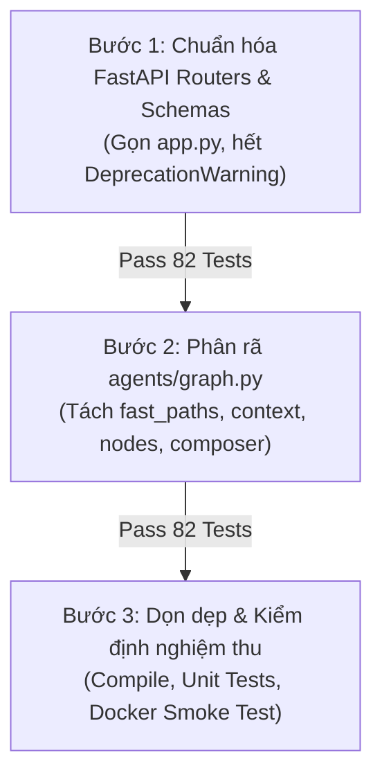

# KẾ HOẠCH TÁI CẤU TRÚC BACKEND: THỰC DỤNG & MODULAR HÓA
## (HEALTH/INBODY AGENT RAG)

> **Trạng thái:** Bản thảo kế hoạch (Proposal / Plan Only) — Chưa thực hiện thay đổi mã nguồn.  
> **Định hướng thiết kế:** **Modular Monolith thực dụng (Practical & Clean)** — Tuyệt đối **không over-engineering** (không đưa thêm các tầng trừu tượng như Hexagonal Architecture, Domain layer hay Ports/Interfaces phức tạp). Giữ nguyên toàn bộ cấu trúc thư mục hiện có của dự án.  
> **Mục tiêu duy nhất:** Phân rã 2 "nồi lẩu thập cẩm" đang phình to:
> 1. [backend/src/agents/graph.py](file:///c:/Users/Admin/Desktop/KLTN/LLL%20RAG/backend/src/agents/graph.py) (**1.490 dòng**) thành các module nhỏ, dễ đọc, dễ viết test riêng lẻ.
> 2. [backend/src/api/app.py](file:///c:/Users/Admin/Desktop/KLTN/LLL%20RAG/backend/src/api/app.py) (**465 dòng**) thành các `APIRouter` chuẩn FastAPI và đưa schemas về đúng nơi.  
> **Nguyên tắc bảo toàn:** Giữ vững 82 unit/integration test đang pass; latency fast-path < 500ms P95; giữ nguyên 100% API contract đối ngoại; không sửa đổi collection Qdrant hay schema PostgreSQL.

---

## 1. Hiện Trạng & Vấn Đề Thật Sự Cần Giải Quyết

Toàn bộ hệ thống backend hiện tại đang chạy tốt (82/82 test pass), các package cấp cao (`rag/`, `llm/`, `persistence/`, `health/`, `harness/`, `jobs/`) đã được phân loại đúng chức năng.

Vấn đề duy nhất khiến code khó bảo trì là sự xuất hiện của **2 "God File"**:

| File cần xử lý | Số dòng | Vấn đề cụ thể |
|---|---|---|
| **`agents/graph.py`** | **1.490 dòng** (~59 KB) | Nhồi nhét toàn bộ: 3 fast-paths, các hàm trích xuất profile/context người dùng, 7 sub-agents, hàm response composer, citation checker, và hàm dựng `StateGraph`. Mỗi lần sửa một agent nhỏ đều phải cuộn qua 1.500 dòng code. |
| **`api/app.py`** | **465 dòng** | Nhồi nhét toàn bộ 15 endpoints (chat, search, admin, health tools, inbody, summarizer). Các Pydantic schemas bị định nghĩa lộn xộn trong file này, khiến `api/schemas.py` phải import ngược từ `app.py`. Có cảnh báo `DeprecationWarning: on_event is deprecated`. |

---

## 2. Cấu Trúc Thư Mục Thực Dụng Sau Tái Cấu Trúc

**Giữ nguyên 100% tên và vị trí các package hiện tại**. Chỉ tổ chức lại bên trong `agents/` và `api/`:

```text
backend/src/
├── agents/                           # TỔ CHỨC LẠI NỘI BỘ (KHÔNG CÒN GOD FILE)
│   ├── __init__.py                   # Giữ nguyên: Re-export multi_agent_handle, get_multi_agent_summary
│   ├── state.py                      # Giữ nguyên: AgentState, append_error, append_trace
│   ├── parsing.py                    # Giữ nguyên: Regex bóc tách số đo InBody
│   ├── fast_paths.py                 # [TÁCH RA] 3 luồng fast-path: Cấp cứu y tế, Chào hỏi, Tính BMI/PBF thuần túy
│   ├── context.py                    # [TÁCH RA] Các hàm trích xuất user profile, số đo gần nhất, mục tiêu từ State
│   ├── composer.py                   # [TÁCH RA] Response Composer, định dạng bằng chứng & kiểm tra citation
│   ├── graph.py                      # [RÚT GỌN ~120 dòng] Chỉ làm nhiệm vụ nối StateGraph và hàm multi_agent_handle
│   └── nodes/                        # [TÁCH RA] Mỗi Sub-Agent là 1 file độc lập, rõ ràng
│       ├── __init__.py
│       ├── normalize.py              # normalize_question_agent
│       ├── supervisor.py             # supervisor_agent (phân tích intent, route)
│       ├── inbody.py                 # inbody_agent (tính toán & phân loại chỉ số)
│       ├── nutrition.py              # nutrition_agent (tính calo, macro, meal plan)
│       ├── training.py               # training_agent (lịch tập kháng lực/cardio)
│       ├── rag.py                    # rag_agent (query rewrite, hybrid search, rerank)
│       ├── web_search.py             # web_search_agent (tìm kiếm web Tavily)
│       ├── general_chat.py           # general_chat_agent (hội thoại thông thường)
│       └── safety.py                 # safety_agent (kiểm tra an toàn y tế)
│
├── api/                              # TỔ CHỨC LẠI THEO CHUẨN FASTAPI ROUTERS
│   ├── __init__.py
│   ├── app.py                        # [RÚT GỌN ~60 dòng] Khởi tạo FastAPI(), lifespan handler, include routers
│   ├── schemas.py                    # [CHUẨN HÓA] Nơi định nghĩa tập trung tất cả Pydantic Request/Response
│   ├── dependencies.py               # [MỚI] Auth context injection, helper dependencies
│   ├── personalization.py            # Giữ nguyên: Router /me (P1 Personalization)
│   └── routers/                      # [TÁCH RA] Gom nhóm endpoints theo domain
│       ├── __init__.py
│       ├── system.py                 # GET /health, GET /healthz
│       ├── chat.py                   # POST /agent/chat, POST /complete
│       ├── health_tools.py           # POST /health/bmi, /body_fat, /visceral_fat, /nutrition, /training
│       ├── rag.py                    # POST /search, POST /search/stats, POST /create_collection, POST /summarize
│       └── legacy_inbody.py          # POST /inbody, POST /user_profile, POST /feedback (backward-compat)
│
├── auth/                             # GIỮ NGUYÊN: Context và xác thực
├── core/                             # GIỮ NGUYÊN: config.py, cache.py, utils.py
├── harness/                          # GIỮ NGUYÊN: Bộ guard phòng vệ (injection, critic, citation, retry)
├── health/                           # GIỮ NGUYÊN: tools.py, legal_tools.py
├── integrations/                     # GIỮ NGUYÊN: tavily.py
├── jobs/                             # GIỮ NGUYÊN: tasks.py (Celery)
├── llm/                              # GIỮ NGUYÊN: client.py, embedding.py, summarizer.py
├── persistence/                      # GIỮ NGUYÊN: database.py, models.py, personalization_service.py
├── pipelines/                        # GIỮ NGUYÊN: import_data.py, import_missing_vectors.py
└── rag/                              # GIỮ NGUYÊN: search.py, rerank.py, query_rewriter.py, qdrant/
```

---

## 3. Lộ Trình Triển Khai 3 Bước Gọn Gàng

Không cần chia 5-6 phase cồng kềnh, chỉ cần **3 bước rõ ràng và an toàn**:



---

### Bước 1: Chuẩn Hóa Tầng API (Schemas & APIRouters)
*Thời lượng ước tính: Nhanh, rủi ro thấp.*

1. **Chuẩn hóa `api/schemas.py`:**
   - Cắt toàn bộ class Pydantic từ `api/app.py` đưa vào `api/schemas.py`.
   - Giữ nguyên `__all__` để bất kỳ module nào đang import schema sẽ không bị ảnh hưởng.
2. **Tạo `api/routers/`:**
   - `routers/system.py`: `/health`, `/healthz`.
   - `routers/chat.py`: `/agent/chat`, `/complete`.
   - `routers/health_tools.py`: Các công cụ `/health/bmi`, `/health/body_fat`, `/health/visceral_fat`, `/health/nutrition`, `/health/training`.
   - `routers/rag.py`: `/search`, `/search/stats`, `/create_collection`, `/summarize`.
   - `routers/legacy_inbody.py`: `/inbody`, `/user_profile`, `/feedback`.
3. **Thu gọn `api/app.py`:**
   - Thay `@app.on_event("startup")` bằng `lifespan(app: FastAPI)` hiện đại để hết cảnh báo.
   - Gọi `app.include_router(...)` cho các router trên.
   - Xóa file placeholder rỗng `api/routes.py`.
* **Tiêu chí nghiệm thu Bước 1:** Chạy pytest đạt 82/82 passed, 0 warnings.

---

### Bước 2: Phân Rã Monolithic `agents/graph.py`
*Thời lượng ước tính: Trọng tâm của đợt tái cấu trúc.*

1. **Tách Fast-paths (`agents/fast_paths.py`):**
   - Đưa `_urgent_answer()`, `_apply_urgent_fast_path()`.
   - Đưa `_try_general_fast_path()`.
   - Đưa `_try_inbody_fast_path()`.
   - *Quy tắc:* Giữ nguyên tính toán thuần túy, tuyệt đối không gọi LLM/RAG trong fast-path.
2. **Tách Context Helpers (`agents/context.py`):**
   - Đưa `_personalization_context()`, `_profile()`, `_latest_measurement()`, `_active_goal()`, `_explicit_goal()`, `_medical_conditions()`.
   - Đưa `_bounded_timeout()`, `_count_call()`, `_trace_call()`.
3. **Tách Response Composer (`agents/composer.py`):**
   - Đưa `response_composer_agent()`, `_build_evidence()`, `_set_evidence_state()`, `_format_docs()`, `_enforce_citation_contract()`, `_fallback_answer()`.
4. **Tạo thư mục `agents/nodes/` cho 7 Sub-Agents:**
   - `nodes/normalize.py`: `normalize_question_agent`
   - `nodes/supervisor.py`: `supervisor_agent`
   - `nodes/inbody.py`: `inbody_agent`
   - `nodes/nutrition.py`: `nutrition_agent`
   - `nodes/training.py`: `training_agent`
   - `nodes/rag.py`: `rag_agent`
   - `nodes/web_search.py`: `web_search_agent`
   - `nodes/general_chat.py`: `general_chat_agent`
   - `nodes/safety.py`: `safety_agent`
5. **Thu gọn `agents/graph.py` còn ~120 dòng:**
   - Chỉ import các nodes từ `agents.nodes` và composer từ `agents.composer`.
   - Giữ hàm `_build_graph()`, `_run_sequential()`, `multi_agent_handle()` và `get_multi_agent_summary()`.
   - Contract hàm `multi_agent_handle(...)` giữ nguyên 100%.
* **Tiêu chí nghiệm thu Bước 2:**
  - `test_agent_fast_paths.py` đạt 100% pass, latency < 100ms trong test.
  - `test_agent_harness_guards.py` đạt 100% pass.
  - Toàn bộ 82 tests pass.

---

### Bước 3: Dọn Dẹp & Kiểm Tra Nghiệm Thu Cuối Cùng
1. Kiểm tra cú pháp toàn bộ file:
   ```powershell
   python -m py_compile backend/src/agents/**/*.py backend/src/api/**/*.py
   ```
2. Chạy test suite:
   ```powershell
   python -B -m pytest backend/tests/unit backend/tests/integration/test_api_fast_paths.py -q -p no:cacheprovider
   ```
3. Kiểm tra tính hợp lệ của Docker Compose YAML:
   ```powershell
   docker compose -f backend/docker-compose.yml config
   ```
4. Kiểm tra Git diff đảm bảo không có thay đổi ngoài ý muốn và không chạm vào data Qdrant / PostgreSQL.

---

## 4. Bảng So Sánh Trước & Sau Tái Cấu Trúc

| Tiêu chí | Trước khi tái cấu trúc | Sau khi tái cấu trúc |
|---|---|---|
| **Kích thước `agents/graph.py`** | 1.490 dòng (quá tải, khó đọc) | ~120 dòng (chỉ khai báo luồng) |
| **Kích thước `api/app.py`** | 465 dòng (chứa 15 endpoints) | ~60 dòng (chỉ đăng ký routers) |
| **Độ độc lập của Agent Nodes** | Gộp chung trong 1 file | Mỗi agent là 1 file riêng trong `agents/nodes/` |
| **Định nghĩa Schemas** | Lộn xộn, import ngược từ app | Tập trung 100% tại `api/schemas.py` |
| **Cảnh báo Framework** | 2 DeprecationWarning về `on_event` | 0 warnings (chuẩn hóa `lifespan`) |
| **Độ phức tạp kiến trúc** | Monolithic file cồng kềnh | **Thực dụng, gọn gàng, không over-engineering** |
| **Số lượng test pass** | 82 passed | **82 passed (Bảo toàn 100%)** |
