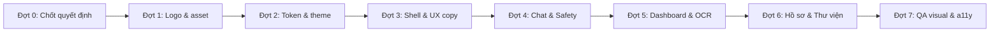

# Kế hoạch thiết kế nhận diện thương hiệu & UI — Health/InBody Agent RAG

> **Trạng thái:** bản kế hoạch, **chưa triển khai**. Chưa có source, asset hay container nào được thay đổi.
> **Ngày lập:** 2026-11-04
> **Phạm vi:** `frontend/` (Next.js 16, React 19, Tailwind v4, Recharts, lucide-react) và tài liệu thiết kế trong `docs/frontend-design/`.
> **Tham chiếu học hỏi:** bộ tài liệu ThiSmart tại `C:\Users\Admin\Desktop\PHP\docs\05-frontend\` (brand guidelines, assets, mockups, motion, wireframes). Chỉ học **cấu trúc và quy trình**, **không** dùng lại logo, tranh minh họa hay tên thương hiệu của ThiSmart.

---

## 0. Tóm tắt điều hành

| Vấn đề hiện tại | Hướng xử lý |
|---|---|
| Chưa có tên thương hiệu; logo là icon `HeartPulse` của Lucide trong ô gradient | Chốt tên + thiết kế logo riêng, **master dạng SVG** |
| `frontend/public/` chỉ còn SVG mặc định của Next (`next.svg`, `vercel.svg`…), favicon mặc định | Bộ favicon, app icon, OG image, `manifest` riêng |
| Màu, bóng, glow viết cứng trong `globals.css` và class Tailwind rải rác (emerald/indigo/rose) | Hệ token ngữ nghĩa qua `@theme` của Tailwind v4 |
| UI lộ thuật ngữ nội bộ: “Multi-Agent”, “Agent RAG”, “Corpus RAG”, “Sandbox”, “fast_path” | Bảng chuyển đổi sang ngôn ngữ người dùng; Dev tools ẩn ở production |
| Banner khẩn cấp dùng `animate-pulse` liên tục | Tuân thủ `prefers-reduced-motion`, nhấn mạnh bằng bố cục chứ không bằng nhấp nháy |
| Chỉ có dark theme | Đề xuất light làm mặc định cho nội dung sức khỏe đọc dài, dark là tùy chọn (**cần chốt**) |

> [!WARNING]
> **“InBody” là nhãn hiệu của InBody Co., Ltd.** Không dùng “InBody” làm tên sản phẩm hay trong logo. Chỉ được dùng mô tả kiểu “phân tích kết quả đo InBody”.

---

## 1. Bài học rút ra từ bộ ThiSmart

### 1.1. Nên học

1. **Một tài liệu brand guideline duy nhất** quy định: tên viết chuẩn, slogan, giá trị cốt lõi, quy tắc ưu tiên.
2. **Asset manifest**: mỗi file có kích thước, nền sáng/tối, vị trí dùng.
3. **Tách kho tư liệu (docs) khỏi runtime (`public/brand/`)**.
4. **Token ngữ nghĩa** (`primary`, `success`, `warning`, `danger` + biến thể `soft`, `border`, `text`) kèm ghi chú tỉ lệ tương phản.
5. **Quy tắc dùng logo**: được phép/cấm, clear space, kích thước theo từng khu vực.
6. **Motion spec** có thời lượng và easing cụ thể (100–600 ms, `cubic-bezier(0.22, 1, 0.36, 1)`).
7. **Quy tắc ưu tiên tối thượng**: nghiệp vụ an toàn > a11y > thương hiệu > trang trí. Với dự án mình: **an toàn y tế > a11y & quyền riêng tư > thương hiệu > trang trí**.
8. **Component `BrandLogo`** và cấu hình `metadata` chuẩn hóa.
9. **Brand Definition of Done**: checklist trước khi nghiệm thu.

### 1.2. Không nên học theo

| Điểm của ThiSmart | Lý do không áp dụng |
|---|---|
| Logo chỉ có PNG raster (1024px), không có SVG | Khó scale, khó chỉnh màu; mình yêu cầu master SVG |
| Tranh 3D claymorphism 1.1–1.5 MB/ảnh, trùng lặp giữa `icon/` và `3d-illustrations/` | Nặng, tốn băng thông; mình giới hạn ≤ 150 KB/ảnh runtime, không trùng file |
| Văn phong marketing (“cao cấp”, “siêu nét”) | App sức khỏe cần giọng điềm tĩnh, không phóng đại |
| Nhiều phiên bản logo 3D | Một bộ logo phẳng là đủ cho đồ án; 3D là tùy chọn |

---

## 2. Định vị thương hiệu

### 2.1. Tên sản phẩm (cần chốt)

| Phương án | Ưu điểm | Rủi ro |
|---|---|---|
| **BodyWise** | Dễ nhớ, nói đúng “hiểu cơ thể” | Tiếng Anh; cần kiểm tra trùng tên |
| **Thể Trạng+** | Tiếng Việt, đúng domain | Dấu tiếng Việt khó làm logo/URL |
| **VitaLens** | Gợi “soi chỉ số” | Trừu tượng hơn |

Tên đầy đủ đề xuất: **`<Tên> — Trợ lý thể trạng & dinh dưỡng AI`**.
Slogan đề xuất: **“Hiểu cơ thể. Sống chủ động.”**

> [!IMPORTANT]
> Slogan và copy **không được** gợi ý chẩn đoán, điều trị hay cam kết kết quả (ví dụ cấm: “giảm 5 kg trong 2 tuần”, “bác sĩ AI”).

### 2.2. Giá trị cốt lõi & giọng nói

- **Đáng tin**: luôn có nguồn tham khảo; nói rõ khi thiếu dữ liệu.
- **Điềm tĩnh**: cảnh báo rõ ràng nhưng không gây hoảng sợ.
- **Rõ ràng**: số liệu kèm đơn vị, ngưỡng và giải thích ngắn.
- **Tôn trọng**: không body-shaming, không dùng hình ảnh “thân hình lý tưởng”.
- **Riêng tư**: người dùng thấy và kiểm soát được dữ liệu AI ghi nhớ.

Giọng văn: xưng “mình/bạn”, câu ngắn, tiếng Việt có dấu, tránh thuật ngữ kỹ thuật.

---

## 3. Logo

### 3.1. Brief ý tưởng (3 concept để chọn)

| Concept | Mô tả | Ý nghĩa |
|---|---|---|
| **A — Vòng thành phần cơ thể** | Chữ cái đầu của tên lồng trong 3 cung tròn đồng tâm (mỡ / cơ / nước) | Phân tích thành phần cơ thể, cân bằng |
| **B — Bong bóng hội thoại + đường xu hướng** | Speech bubble bo tròn, bên trong là đường biểu đồ đi lên mềm | Trợ lý AI + theo dõi tiến trình |
| **C — Lá + điểm dữ liệu** | Chiếc lá cách điệu tạo từ các chấm dữ liệu | Dinh dưỡng, sống khỏe, dựa trên dữ liệu |

**Cấm:** dấu thập đỏ, ống nghe, nhịp tim ECG, hình người cơ bắp/gầy, icon Lucide làm logo. Dấu thập đỏ và ECG gợi thiết bị/dịch vụ y tế, sai định vị và có rủi ro pháp lý.

### 3.2. Bộ giao nộp

Master đặt tại `docs/frontend-design/assets/brand/`, runtime copy sang `frontend/public/brand/`:

| File runtime | Định dạng | Dùng ở đâu |
|---|---|---|
| `logo-horizontal-light.svg` | SVG | Sidebar mở rộng, trang chào |
| `logo-horizontal-dark.svg` | SVG | Nền tối |
| `logo-mark.svg` | SVG | Sidebar thu gọn, avatar trợ lý trong chat |
| `logo-mono.svg` | SVG 1 màu | In ấn, watermark báo cáo PDF |
| `favicon.ico` (16/32/48) | ICO | Tab trình duyệt |
| `icon-192.png`, `icon-512.png`, `icon-maskable-512.png` | PNG | PWA manifest |
| `apple-touch-icon.png` | PNG 180×180 | iOS |
| `og-image.png` | PNG 1200×630, ≤ 150 KB | Chia sẻ link; **không chứa số liệu người dùng thật** |
| `manifest.webmanifest` | JSON | PWA |

### 3.3. Quy tắc dùng

- Clear space ≥ 1/4 chiều cao mark; kích thước tối thiểu của mark là 16 px.
- Sidebar: cao 28–32 px; header mobile: 24 px; trang chào: 40–48 px.
- Cấm kéo méo, xoay, đổ bóng, đổi màu bằng CSS filter, hay đặt bản sáng lên nền sáng.
- Phải đọc rõ ở 16×16 px. Đây là test bắt buộc khi chọn concept.

---

## 4. Design tokens

### 4.1. Màu thương hiệu & bề mặt (light mặc định)

| Token | Giá trị | Ghi chú |
|---|---|---|
| `--color-brand-600` | `#0D9488` (teal 600) | Chỉ dùng cho trang trí, icon, viền focus; **không** dùng cho chữ nhỏ (≈ 3.7:1 trên nền trắng) |
| `--color-brand-700` | `#0F766E` | Nền nút chính có chữ trắng, link (≈ 5.5:1) |
| `--color-brand-800` | `#115E59` | Hover/active |
| `--color-brand-soft` | `#F0FDFA` | Nền mục đang chọn |
| `--color-accent` | `#0284C7` (sky 600) | Dữ liệu/biểu đồ phụ, citation |
| `--color-ink` | `#0F172A` | Chữ chính |
| `--color-muted` | `#475569` | Chữ phụ (≥ 4.5:1) |
| `--color-bg` | `#F8FAFC` | Nền trang |
| `--color-surface` | `#FFFFFF` | Card, bubble |
| `--color-border` | `#E2E8F0` | Viền 1 px |

Dark theme dùng lại cấu trúc hiện có (`#0B1220` / `#111C32` / `#334155`), brand chuyển sang `#2DD4BF` cho chữ.

> [!NOTE]
> Lý do đổi từ emerald (`#10B981`) sang teal: emerald quá gần màu “Bình thường/Đạt” của trạng thái chỉ số, dễ làm người dùng nhầm “nút bấm” với “kết quả tốt”.

### 4.2. Màu ngữ nghĩa & an toàn

| Nhóm | Base | Soft | Text | Dùng cho |
|---|---|---|---|---|
| `success` | `#059669` | `#ECFDF5` | `#065F46` | Đã lưu, trong ngưỡng tham khảo |
| `warning` | `#D97706` | `#FFFBEB` | `#92400E` | `caution`, chỉ số cần chú ý |
| `danger` | `#E11D48` | `#FFF1F2` | `#9F1239` | **Chỉ** dành cho `urgent` và lỗi nghiêm trọng |
| `info` | `#0284C7` | `#F0F9FF` | `#075985` | Gợi ý, nguồn tham khảo |

> [!IMPORTANT]
> `danger` được dành riêng cho cảnh báo khẩn cấp. Không dùng đỏ cho nút xóa thông thường hay chỉ số hơi cao, để người dùng không bị “mù cảnh báo”.

### 4.3. Thang màu phân loại chỉ số (WHO châu Á/WPRO)

| Phân loại BMI | Token | Màu | Nhãn bắt buộc đi kèm |
|---|---|---|---|
| < 18.5 | `--metric-under` | `#0284C7` | “Thiếu cân” |
| 18.5–22.9 | `--metric-normal` | `#059669` | “Bình thường” |
| 23.0–24.9 | `--metric-over` | `#D97706` | “Thừa cân” |
| ≥ 25.0 | `--metric-obese` | `#C2410C` | “Béo phì” |
| Mỡ nội tạng ≥ 10 | `--metric-risk` | `#C2410C` | “Nguy cơ cao — nên hỏi ý kiến bác sĩ” |

Quy tắc: **không truyền đạt bằng màu đơn thuần**. Luôn kèm nhãn chữ và vị trí trên thước đo, để người mù màu vẫn đọc được. Ngưỡng hiển thị phải lấy từ tool deterministic của backend, frontend không tự định nghĩa lại.

### 4.4. Typography

- Font chính: **Be Vietnam Pro**, vì được thiết kế cho tiếng Việt. Nếu không muốn đổi thì giữ **Plus Jakarta Sans** (đã có subset `vietnamese`). **Cần chốt.**
- Mono: JetBrains Mono, chỉ dùng cho Dev tools.
- Thang chữ: 12 / 14 / 16 / 18 / 20 / 24 / 30 px; nội dung chat 15–16 px, line-height 1.65, tối đa ~72 ký tự/dòng.
- Số KPI, bảng lịch sử, latency: `font-variant-numeric: tabular-nums`.

### 4.5. Spacing, radius, shadow, motion

- Spacing theo bước 4 px: 4, 8, 12, 16, 20, 24, 32, 40, 48.
- Radius: input/nút 10 px · card 16 px · modal 20 px · chip 9999 px.
- Shadow: `0 1px 2px rgba(15,23,42,.04), 0 4px 16px rgba(15,23,42,.04)`. Bỏ glow neon và glassmorphism ở nền sáng.
- Motion: hover 150 ms · panel/menu 250–300 ms · easing `cubic-bezier(0.22, 1, 0.36, 1)`.
- Bắt buộc có `@media (prefers-reduced-motion: reduce)`. **Không** dùng animation lặp vô hạn cho cảnh báo.

Triển khai bằng `@theme` trong `frontend/src/app/globals.css` (Tailwind v4), xóa dần màu hard-code như `bg-[#070b14]` và `emerald-500/20`.

---

## 5. Icon & minh họa

### 5.1. Icon giao diện

- Tiếp tục dùng **lucide-react**, stroke 1.75–2, kích thước 16/20/24.
- Bộ **icon domain tùy biến** (SVG, cùng grid 24 px): BMI, PBF, SMM, BFM, mỡ nội tạng, cân nặng, dinh dưỡng, lịch tập, quét phiếu OCR, nguồn tham khảo, an toàn, trí nhớ cá nhân.

### 5.2. Minh họa

- Phong cách: phẳng/2.5D mềm, tông teal–sky, nền trong suốt; WebP/SVG ≤ 150 KB.
- Dùng cho: trạng thái trống (chưa có lần đo, chưa có hồ sơ), onboarding, lỗi kết nối, hướng dẫn chụp phiếu đo.
- **Đa dạng hình thể, tuổi, giới**. Không có ảnh “trước/sau”, không có giải phẫu chân thực, không có nhân vật bác sĩ.

Cấu trúc kho:

```text
docs/frontend-design/
├── KE_HOACH_THIET_KE_UI_THUONG_HIEU.md   # tài liệu này
├── BRAND_GUIDELINES.md                    # tạo ở Đợt 1
└── assets/
    ├── brand/          # master SVG, bảng concept, bảng favicon
    ├── icons/          # icon domain SVG + icons.json
    ├── illustrations/  # minh họa empty state/onboarding
    └── mockups/        # ảnh chụp UI với dữ liệu giả
```

Quy ước tên: trong docs dùng `snake_case` tiếng Việt không dấu (giống ThiSmart); runtime trong `public/` dùng `kebab-case` tiếng Anh.

---

## 6. Ngôn ngữ giao diện (UX copy)

| Hiện tại (nội bộ) | Đề xuất hiển thị |
|---|---|
| “Multi-Agent”, “Agent RAG” | Ẩn; nếu cần thì dùng “Trợ lý AI” |
| “Tra cứu Corpus RAG” | “Thư viện kiến thức” |
| “Hệ thống & Sandbox” | Chỉ hiện khi `NODE_ENV !== 'production'` hoặc có quyền dev |
| `fast_path`, `selected_agents`, latency | Ẩn sau nút “Chi tiết kỹ thuật” (chỉ dev) |
| `status: degraded` | “Câu trả lời rút gọn vì hệ thống đang bận. Bạn có thể thử lại sau.” |
| `status: error` | “Chưa thể trả lời lúc này. Vui lòng thử lại.” (không hiện stack trace) |
| Citations | “Nguồn tham khảo” + tên tài liệu đã escape |
| Context yếu | “Mình chưa tìm thấy tài liệu đủ tin cậy cho câu hỏi này.” |

Mọi câu trả lời có nội dung sức khỏe đều có dòng miễn trừ cố định, kiểu chữ phụ: *“Thông tin chỉ mang tính tham khảo, không thay thế tư vấn của bác sĩ.”*

---

## 7. Đặc tả theo màn hình

Shell: sidebar 264 px (thu gọn 72 px), header mỏng. Mobile dùng bottom nav 4 mục: Trò chuyện · Chỉ số · Hồ sơ · Thư viện.

### 7.1. Trò chuyện (ưu tiên cao nhất)

- Thứ tự trong một câu trả lời: **SafetyBanner → nội dung → Nguồn tham khảo → miễn trừ**. Nội dung LLM không bao giờ được che hay đẩy cảnh báo xuống dưới.
- **Urgent**: banner nền `danger-soft`, viền trái 4 px `danger`, tiêu đề “Cần hỗ trợ y tế ngay”, nút lớn “Gọi 115” (≥ 44 px), `role="alert"`. Không skeleton, không “AI đang suy nghĩ”, vì đây là fast-path.
- **Caution**: banner `warning-soft`, có thể thu gọn nhưng mặc định mở.
- Quick prompts: 4 thẻ chia theo nhóm Chỉ số / Dinh dưỡng / Lịch tập / An toàn.
- Trạng thái chờ: skeleton 3 dòng + nút “Dừng”. Hiển thị timeout thân thiện (frontend timeout > backend hard timeout).

### 7.2. Chỉ số cơ thể (InBody Dashboard)

- 6 KPI card: giá trị (tabular), đơn vị, delta so với lần trước (mũi tên + chữ, không chỉ màu), badge phân loại.
- Thước đo ngang có vạch ngưỡng WPRO cho BMI và PBF (theo giới tính sinh học), mỡ nội tạng có mốc 9/10.
- Biểu đồ Recharts: tối đa 2 series mỗi chart, palette `brand-700` + `accent`, đường tham chiếu dùng nét đứt `warning`. Có bảng dữ liệu thay thế cho trình đọc màn hình.
- Empty state: minh họa + “Thêm lần đo đầu tiên” + “Quét phiếu đo”.

### 7.3. Quét phiếu đo (OCR)

- 3 bước có stepper: Tải ảnh → Kiểm tra số liệu → Lưu.
- Bảng đối chiếu: trường nào OCR không chắc chắn thì viền `warning` + icon. Bắt buộc người dùng xác nhận trước khi lưu.
- Ghi chú quyền riêng tư cạnh vùng tải ảnh: ảnh được xử lý thế nào và lưu bao lâu (theo chính sách P2).

### 7.4. Hồ sơ, mục tiêu & trí nhớ

- Tách 3 tab: Hồ sơ · Mục tiêu & check-in · Điều AI ghi nhớ.
- Mỗi “fact” có nút **Xác nhận** / **Xóa**. Xóa dùng hộp thoại xác nhận, nút xóa kiểu `outline`, không đỏ đặc.
- Trường bệnh nền/dị ứng có nhãn “Dữ liệu nhạy cảm”.

### 7.5. Thư viện kiến thức

- Bộ lọc chủ đề dạng chip; kết quả hiển thị tiêu đề, nguồn và đoạn trích đã escape. Ẩn điểm “% match” khỏi người dùng thường (chỉ dev mới thấy).

### 7.6. Chi tiết kỹ thuật (Dev)

- Giữ AgentTrace, Tool sandbox, health check; chỉ build/hiển thị ở môi trường dev.

---

## 8. Component cần chuẩn hóa

| Component | Vị trí đề xuất | Ghi chú |
|---|---|---|
| `BrandLogo` | `components/branding/BrandLogo.tsx` | Props `variant: horizontal \| mark`, `theme`, `href` |
| `AppShell`, `Sidebar`, `MobileNav` | `components/layout/` | Responsive, phím tắt |
| `Button`, `IconButton`, `Badge`, `Chip`, `Card`, `Dialog` | `components/ui/` | Đủ trạng thái hover, focus-visible, active, disabled, loading |
| `SafetyBanner` | `components/chat/` | 3 mức; có regression test snapshot |
| `MetricGauge`, `ClassificationBadge`, `KpiCard` | `components/inbody/` | Màu lấy từ token `--metric-*` |
| `CitationList` | `components/chat/` | Escape title/source/content |
| `EmptyState`, `ErrorState`, `Skeleton` | `components/feedback/` | Copy tiếng Việt chuẩn |
| `MedicalDisclaimer` | `components/feedback/` | Văn bản cố định |

---

## 9. Accessibility & quyền riêng tư trên UI

- WCAG 2.2 AA: chữ thường ≥ 4.5:1, chữ lớn/icon ≥ 3:1, focus ring 2 px `brand-600` có offset.
- Vùng chạm ≥ 44×44 px; điều khiển được hoàn toàn bằng bàn phím; `aria-live="polite"` cho tin nhắn mới, `role="alert"` cho urgent.
- `lang="vi"`; không dùng chữ viết hoa toàn bộ cho đoạn dài.
- Mockup, OG image, ảnh chụp báo cáo: **chỉ dùng dữ liệu giả**.
- Không lưu chỉ số sức khỏe vào `localStorage` nếu chưa có quyết định ở P1/P2.

---

## 10. Lộ trình triển khai



| Đợt | Nội dung | Đầu ra | Kiểm chứng |
|---|---|---|---|
| 0 | Chốt tên, concept logo, theme mặc định, font | Ghi quyết định vào tài liệu này | Người dùng duyệt |
| 1 | Vẽ logo SVG, xuất favicon/PWA/OG; viết `BRAND_GUIDELINES.md` | `assets/brand/`, `public/brand/` | Đọc rõ ở 16 px; tổng runtime asset ≤ 500 KB |
| 2 | Token `@theme`, light/dark, reduced-motion | `globals.css` | Script kiểm tra tương phản; `npm run lint && npm run build` |
| 3 | `BrandLogo`, AppShell responsive, áp dụng bảng UX copy, ẩn Dev ở prod, `metadata` + manifest | `components/branding`, `layout` | Build prod không còn chữ “Agent RAG/Sandbox”; screenshot 1440/768/390 |
| 4 | SafetyBanner 3 mức, thứ tự hiển thị, citation, degraded/error state | `components/chat` | Test urgent: banner hiện, không skeleton; HTTP smoke test chào/BMI/đau ngực |
| 5 | KpiCard, MetricGauge, chart palette, OCR stepper | `components/inbody` | So ngưỡng với tool backend; kiểm tra mù màu (giả lập deuteranopia) |
| 6 | Tab hồ sơ/trí nhớ, Thư viện kiến thức, empty state | `components/profile`, `search` | Không lộ dữ liệu giữa 2 user test |
| 7 | Rà visual, bàn phím, screen reader, Lighthouse | Báo cáo trong `docs/reports/` | Lighthouse a11y ≥ 95; không lỗi nghiêm trọng |

> [!NOTE]
> Mỗi đợt là một patch nhỏ, độc lập. Đợt 4 chạm vào hiển thị safety nên phải có regression test trước khi sửa, theo `AGENTS.md` mục 4.2. Không gộp redesign với thay đổi backend/Qdrant.

---

## 11. Brand & UI Definition of Done

- [ ] Tên sản phẩm viết đúng chuẩn ở sidebar, `<title>`, OG, manifest.
- [ ] Không còn icon Lucide hay asset mặc định của Next làm logo/favicon.
- [ ] Không còn màu hex hard-code ngoài file token.
- [ ] Không có thuật ngữ nội bộ ở giao diện production.
- [ ] Cảnh báo urgent luôn nằm trên cùng, có nút 115, không bị nội dung LLM che.
- [ ] Mọi trạng thái chỉ số có nhãn chữ, không chỉ dựa vào màu.
- [ ] Dòng miễn trừ y tế xuất hiện ở câu trả lời sức khỏe.
- [ ] Tương phản đạt AA; có reduced-motion; điều hướng được bằng bàn phím.
- [ ] Ảnh mockup/OG chỉ chứa dữ liệu giả.
- [ ] `npm run lint` và `npm run build` đạt; screenshot 3 breakpoint được lưu.

---

## 12. Quyết định cần người dùng chốt

1. **Tên thương hiệu**: BodyWise / Thể Trạng+ / VitaLens / tên khác?
2. **Concept logo**: A (vòng thành phần cơ thể), B (bubble + xu hướng) hay C (lá + dữ liệu)?
3. **Theme mặc định**: light (đề xuất) hay giữ dark?
4. **Font**: Be Vietnam Pro (đề xuất) hay giữ Plus Jakarta Sans?
5. **Cách tạo asset**: tự vẽ SVG thủ công/Figma, hay dùng AI tạo concept rồi vector hóa lại?

