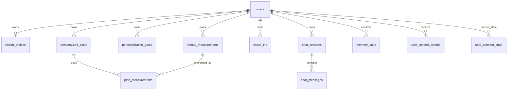

# Kiểm kê hệ thống trước khi thiết kế lại CSDL

**Ngày đối chiếu:** 2026-10-11. **Trạng thái:** khảo sát source, chưa đổi schema hoặc dữ liệu.

## Cập nhật kiểm chứng source — 2026-10-16

Đợt rà soát này kiểm tra lại các đường đi dữ liệu trong working tree hiện tại và
chỉ bổ sung bằng chứng source/runtime. Working tree có nhiều thay đổi sẵn có;
đây không phải một release commit đồng nhất. Không sửa schema, migration, dữ liệu,
service hoặc collection trong đợt này.

### Đã xác minh từ source

| Chủ đề | Bằng chứng trong checkout hiện tại | Kết luận và giới hạn |
|---|---|---|
| Identity và auth | [`auth/context.py`](../../backend/src/auth/context.py#L34-L90), [`api/app.py`](../../backend/src/api/app.py#L225-L288) | `/me` lấy subject từ `request.state.current_user`; chỉ `AUTH_MODE=development` cho phép `X-Dev-User-Id`. Legacy `/users/{user_id}` bị giới hạn development + `ENABLE_LEGACY_USER_ENDPOINTS` và phải trùng subject. Trong repo không thấy issuer/JWT/IdP middleware tạo `request.state.current_user`; production identity phụ thuộc lớp triển khai bên ngoài và chưa được xác minh. |
| Hai đường personalization | [`api/personalization.py`](../../backend/src/api/personalization.py#L75-L252), [`persistence/personalization_service.py`](../../backend/src/persistence/personalization_service.py#L96-L174), [`persistence/personalization.py`](../../backend/src/persistence/personalization.py#L71-L160), [`api/app.py`](../../backend/src/api/app.py#L225-L283) | `/me` dùng service owner-scoped, consent và confirmation; legacy helper CRUD theo `external_id` vẫn được route development gọi. Cần tránh để test/dev path bị hiểu là contract production hoặc tạo hai hành vi ghi khác nhau. |
| OCR | [`api/app.py`](../../backend/src/api/app.py#L74-L76), [`api/inbody_ocr.py`](../../backend/src/api/inbody_ocr.py#L42-L83), [`frontend/chat_interface_new.py`](../../frontend/chat_interface_new.py#L1599-L1608) | Router và UI đều bị feature flag mặc định tắt. Gateway kiểm tra consent, giới hạn file và chuyển tiếp nội dung tới OCR service; hàm trả kết quả `needs_confirmation` mà không ghi DB. UI giữ draft trong session state; cần xác nhận người dùng trước khi gọi endpoint measurements. Không có bằng chứng source về lưu file/extraction/parser version vào bảng `uploaded_files`. |
| PostgreSQL và ledger | [`database/init.sql`](../../database/init.sql#L1-L10), [schema cài mới](../../database/init.sql#L12-L234), [P1 migration](../../database/migrations/20260815_01_p1_personalization.up.sql#L1-L105), [memory migration](../../database/migrations/20260929_02_memory.up.sql#L1-L33) | `init.sql` khai báo 12 bảng nghiệp vụ nhưng chỉ ghi ledger P1; memory migration riêng mới ghi `20260929_02_memory`. Cài mới cần chạy/ghi nhận migration memory để ledger phản ánh cùng hợp đồng nâng cấp. Đây là khác biệt source-level, không phải xác nhận ledger live đang sai. |
| Migration execution | [`persistence/database.py`](../../backend/src/persistence/database.py#L57-L62), [database README](../../database/README.md#L8-L27) | Có helper `init_db()` gọi `Base.metadata.create_all()` nhưng không tìm thấy caller trong `backend/src`; tài liệu hướng dẫn áp dụng SQL thủ công. Không thấy migration runner tự chạy ở startup trong source đã rà. Cần chốt một đường triển khai được quản lý và parity gate; không dùng `create_all()` thay migration. |
| Dữ liệu chat và retention | [`memory/store.py`](../../backend/src/memory/store.py#L21-L57), [`memory/store.py`](../../backend/src/memory/store.py#L61-L99), [`memory/store.py`](../../backend/src/memory/store.py#L236-L271), [`jobs/tasks.py`](../../backend/src/jobs/tasks.py#L15-L21), [`jobs/tasks.py`](../../backend/src/jobs/tasks.py#L353-L358) | PostgreSQL lưu session/message/fact/task ownership; transcript được lọc/purge khi đọc/job chạy, 7 ngày mặc định cấu hình 1–30, tối đa 40 message/session và 20 session/user. Celery result backend có TTL 1 giờ trong cấu hình source. Việc purge vật lý còn phụ thuộc Beat/worker và các kho ngoài; chưa xác minh scheduler đang chạy. |
| Memory và Zep | [`memory/store.py`](../../backend/src/memory/store.py#L115-L168), [`memory/sync.py`](../../backend/src/memory/sync.py#L14-L73), [`api/personalization.py`](../../backend/src/api/personalization.py#L41-L59) | Fact được đề xuất từ message và cần xác nhận; Zep chỉ đồng bộ fact confirmed khi cờ consent bật. Trạng thái consent/sync nằm trong `users.consent_flags` (JSONB), chưa thấy bảng event log/outbox bền vững. Sync/revoke serialize bằng khóa dòng user trong lúc thao tác provider; có thể kéo dài transaction/lock khi mạng chậm. Thời gian sync/xóa live chưa biết. |
| Async chat | [`api/app.py`](../../backend/src/api/app.py#L320-L348), [`jobs/tasks.py`](../../backend/src/jobs/tasks.py#L337-L350), [`memory/store.py`](../../backend/src/memory/store.py#L219-L234) | SQL giữ task ID, owner và expiry; Celery giữ args/result trong broker/result backend. Do đó xóa SQL row đơn lẻ không chứng minh payload/result đã bị xóa khỏi Valkey/Celery. |
| Corpus và catalog SQL | [`api/app.py`](../../backend/src/api/app.py#L429-L455), [`jobs/tasks.py`](../../backend/src/jobs/tasks.py#L73-L126), [`pipelines/import_data.py`](../../backend/src/pipelines/import_data.py#L443-L682), [`persistence/models.py`](../../backend/src/persistence/models.py#L184-L214) | API index và importer ghi trực tiếp Qdrant; importer tạo ID/hash/version ổn định và manifest. `documents`/`document_chunks` có trong SQL/ORM nhưng không tìm thấy caller `insert_document()` trong `backend/src`; chưa có bằng chứng chúng là catalog đồng bộ. Hai đường index cũng cần giữ cùng contract provenance/admission. |
| Xóa/export/account lifecycle | [`api/personalization.py`](../../backend/src/api/personalization.py#L49-L59), [`api/memory.py`](../../backend/src/api/memory.py#L19-L58), [API route inventory](../../backend/src/api/personalization.py#L124-L244) | Có xóa conversation/fact/memory mirror và soft-delete measurement; không thấy endpoint account delete, health-data export hoặc coordinator tổng hợp xóa PostgreSQL + Zep + Valkey/result + files. Không suy ra không có policy vận hành ngoài repo. |

### Runtime chỉ đọc và giới hạn truy cập

- `docker ps --format '{{.Names}} {{.Status}}'` trả lỗi Docker Engine: access denied.
- GET `http://127.0.0.1:8000/health` bị Windows socket permission denied trước khi nhận HTTP response.
- Kiểm tra TCP PostgreSQL không thực hiện được do CIM resource access denied.
- Vì vậy **không có kết quả runtime PostgreSQL/API** trong lượt này: server/version, migration ledger, bảng/cột/constraint live, aggregate counts, orphan/duplicate/owner mismatch, backup/restore và worker/Beat status đều **CHƯA BIẾT**. Không diễn giải lỗi quyền truy cập là service đang down.

### Hệ quả cho thiết kế đích và bước kế tiếp

Thiết kế đề xuất tại [master plan](10-database-schema-master-plan.md) vẫn là chuẩn để review, chưa được phê duyệt hoặc triển khai. Bằng chứng mới củng cố thứ tự: (1) lấy read-only access để so schema live với init/migrations/ORM; (2) xác minh auth issuer/context và các caller legacy; (3) chốt retention, account deletion/export và consent history; (4) chỉ sau đó mới chốt mapping/backfill và migration additive. Không có cơ sở để rebuild toàn bộ PostgreSQL; hiện trạng phù hợp với chuẩn hóa theo từng đợt nếu audit live không phát hiện blocker mới.

Mapping source-to-target, ADR, kế hoạch expand/backfill/cutover/rollback, ERD, data dictionary và test matrix đang được gom trong master plan mục 5, 11–16. Các phần này là **ĐỀ XUẤT**; mọi DDL, backfill, deploy và runtime gate còn **CHƯA THỰC HIỆN**.

Tài liệu này bổ sung bằng chứng hiện trạng cho [kế hoạch CSDL tổng thể](10-database-schema-master-plan.md). `database/init.sql` và hai migration cho biết schema dự kiến của source; chúng **không chứng minh** cấu trúc của PostgreSQL đang chạy. Lần kiểm tra này `docker ps` không kết nối được Docker daemon, nên chưa có schema live, row count, tình trạng backup hoặc kết quả restore. Workspace đang có nhiều thay đổi chưa commit; các nhận định dưới đây dựa trên file hiện thời, không phải một release đã deploy.

## 1. Dữ liệu đi qua hệ thống như thế nào

| Luồng | Cách vận hành thấy trong source | Nơi dữ liệu nằm / giới hạn |
|---|---|---|
| Hồ sơ và tiến độ | `/me/profile`, `/me/measurements`, `/me/goals`, `/me/plans`, `/me/check-ins` gọi `personalization_service.py`, resolve `users` theo auth subject rồi lọc owner. | PostgreSQL; chỉ measurement đã xác nhận và chưa soft-delete đi vào progress/context. |
| OCR InBody | Streamlit gửi ảnh/PDF tới `/me/inbody-ocr`; gateway kiểm tra consent, gọi OCR service; UI cho sửa và xác nhận từng chỉ số trước `POST /me/measurements`. | Gateway OCR hiện không ghi file hay kết quả OCR vào DB. UI giữ kết quả nháp trong session; PostgreSQL chỉ nhận các chỉ số cuối cùng với `source_type=ocr_confirmed` hoặc `manual_confirmed`. Không có parser version/giá trị OCR gốc kèm measurement. |
| Hội thoại | `run_chat` kiểm tra urgent trước; hội thoại thường nạp history theo session, rồi ghi một lượt user/assistant vào PostgreSQL. | `chat_sessions`, `chat_messages`; giới hạn 20 session/user, 40 message/session. Chính sách giữ chat mặc định 7 ngày được thực thi khi đọc hoặc khi purge job chạy, không phải TTL tự động ở PostgreSQL. Lỗi ghi memory làm giảm chất lượng, không chặn câu trả lời. |
| Fact dài hạn | Một số câu chat trở thành đề xuất; người dùng phải xác nhận. | `memory_facts`; pending 7 ngày, confirmed 180 ngày. `source_message_id` có FK tới message nhưng DB chưa chứng minh cùng owner. |
| Zep | Đồng bộ/recall sở thích đã xác nhận khi có consent; `consent_flags` đồng thời chứa cờ đồng bộ/xóa. | PostgreSQL là nguồn chuẩn; Zep là bản sao. Sync giữ lock dòng `users` trong lúc gọi mạng; chưa có outbox/epoch bền vững. |
| Chat bất đồng bộ | Tạo `chat_tasks` để kiểm tra quyền lấy kết quả; Celery xử lý và trả kết quả qua result backend. | SQL chỉ lưu task ID/owner/expiry. Payload và result nằm ở queue/result backend; vòng đời xóa phải bao gồm cả Valkey. |
| Tri thức y khoa | Importer tạo stable chunk/point ID, corpus version, manifest và upsert vào Qdrant; đường API index riêng cũng ghi thẳng Qdrant. | `documents`/`document_chunks` có trong SQL/ORM, nhưng tìm trong `backend/src` không thấy caller cho `insert_document`; hai đường index đang đọc/ghi Qdrant trực tiếp. Chưa thể xem hai bảng SQL là catalog provenance đang đồng bộ. |

Nguồn chính: [API](../../backend/src/api/app.py), [personalization service](../../backend/src/persistence/personalization_service.py), [OCR gateway](../../backend/src/api/inbody_ocr.py), [UI OCR](../../frontend/chat_interface_new.py), [memory store](../../backend/src/memory/store.py), [Zep sync](../../backend/src/memory/sync.py), [index API](../../backend/src/jobs/tasks.py), [bulk importer](../../backend/src/pipelines/import_data.py).

## 2. Data dictionary hiện tại ở mức bảng

`database/init.sql` khai báo **12 bảng nghiệp vụ và một ledger**. Số này là kiểm kê DDL, không phải số bảng live.

| Bảng | Owner / quan hệ | Vai trò và điểm cần xem khi thiết kế lại |
|---|---|---|
| `users` | `id` UUID, `external_id` unique | Trộn định danh, profile legacy/P1, consent và cờ Zep; chưa có issuer/subject riêng. |
| `inbody_measurements` | `user_id` NOT NULL, cascade | Metric có kiểu; source, confidence, confirmed, soft-delete. Chưa có revision/provenance theo trường OCR; DB thiếu phần lớn range/state checks đang có trong Pydantic. |
| `personalization_goals` | `user_id` NOT NULL, cascade | Version theo user và partial unique cho active; `supersedes_goal_id` chỉ FK theo ID, chưa ràng owner. |
| `personalized_plans` | `user_id` NOT NULL, cascade | Version/active; `goal_version` và `measurement_ids` nằm trong cột scalar/JSONB, DB không thể kiểm chứng tồn tại và cùng owner. Snapshot/citation có thể giữ bản sao dữ liệu đã soft-delete. |
| `check_ins` | `user_id` NOT NULL, cascade | Theo dõi với safety result; chưa có liên kết trực tiếp tới plan. |
| `chat_sessions` | `user_id` nullable, `ON DELETE SET NULL` | Session mới từ memory store có owner, nhưng schema cho phép session mồ côi; còn `external_user_id` dư thừa. |
| `chat_messages` | `session_id` NOT NULL, cascade | Nội dung chat; DB chưa ràng role, thứ tự/idempotency hoặc expiry tại từng message. |
| `memory_facts` | `user_id` NOT NULL; source message nullable | Pending/confirmed/rejected và expiry; FK source message riêng lẻ không bảo vệ cùng owner. |
| `chat_tasks` | `user_id` NOT NULL, cascade | Chỉ là chứng từ quyền truy cập task trong 1 giờ, không phải nơi lưu answer chuẩn. |
| `uploaded_files` | `user_id` nullable, `ON DELETE SET NULL` | Bảng có cột path/OCR text nhưng OCR gateway hiện không ghi vào đây; không mở upload lưu trữ trước khi có owner, storage và delete lifecycle. |
| `documents` | Public corpus, không có user owner | Có content và metadata; chưa là catalog chuẩn của importer hiện hành. |
| `document_chunks` | `document_id` nullable; `qdrant_point_id` unique | Chưa được importer hiện hành duy trì. Một point ID có thể lặp giữa collection/corpus version, nên unique toàn lịch sử là không đủ namespace. |
| `schema_migrations` | Version PK | Fresh `init.sql` tạo cả memory tables nhưng chỉ ghi version P1; upgrade memory ghi version riêng. Fresh/upgrade ledger không tương đương. |

Các khóa/kiểu trên lấy từ [SQL cài mới](../../database/init.sql), [ORM P1](../../backend/src/persistence/models.py), [ORM memory](../../backend/src/memory/models.py). ORM `Base.metadata.create_all()` tồn tại trong helper nhưng không có caller trong `backend/src` theo tìm kiếm tĩnh; không dùng nó làm runner migration live.

## 3. Bất biến phải bảo vệ trong thiết kế đích

Sơ đồ là **đích logic**, không phải ERD đã được tạo trong database. `health_profiles`, `plan_measurements`, `user_consent_events` và `user_consent_state` chưa tồn tại. Các bảng còn lại có thể cần thêm cột/ràng buộc; không nên dựng cả sơ đồ bằng một migration.

1. Mọi dữ liệu riêng tư mới phải có owner hợp lệ. Session/file owner NULL cũ cần kiểm kê và xử lý theo chứng cứ, không đoán từ text/email.
2. Liên kết `plan → goal`, `plan → measurement`, `fact → source message` phải cùng owner. Chỉ FK tới ID là chưa đủ. Với `chat_messages`, muốn DB chứng minh owner của source message cần thêm owner qua session hoặc cơ chế DB tương đương, rồi kiểm thử bằng hai user.
3. `confirmed_by_user=true` phải đi cùng `confirmed_at`; `source_type` mô tả cách có dữ liệu và confirmation mô tả ai duyệt. OCR chỉ là nháp cho tới khi người dùng xác nhận. Thay đổi metric đã xác nhận cần revision/nguồn sửa để plan cũ không bị diễn giải sai.
4. Consent hiện tại phải có mục đích, phiên bản thông báo, thời điểm/actor và lịch sử cấp/thu hồi. Chuyển từ `consent_flags` chỉ có thể tạo **legacy state chưa xác minh**, không được bịa một event đồng ý trong quá khứ.
5. Xóa account hoặc thu hồi consent phải xử lý SQL, Qdrant nếu có dữ liệu cá nhân, Zep, Valkey/result backend, file và backup/restore policy. `ON DELETE CASCADE` riêng SQL không hoàn tất quyền xóa.
6. Catalog corpus chỉ mở khi importer, API index, BM25, Qdrant và citation cùng ghi/đọc một `document_id + revision + corpus_version + chunk_id`. Không trộn personal OCR vào public corpus.

## 4. Thứ tự thiết kế lại có thể triển khai

| Ưu tiên | Việc cần chốt | Đầu ra đủ để review |
|---|---|---|
| 0 | Inventory PostgreSQL live bằng quyền read-only: server version, ledger, bảng/cột/FK/index/CHECK, aggregate NULL/orphan/owner mismatch, row count, backup/restore status; đo query/lock. | Báo cáo số liệu tổng hợp, schema diff giữa live/fresh/upgrade/ORM; không xuất raw health data. |
| 1 | Xử lý owner NULL/legacy writers, quyết định retention và nghĩa của hide vs erase; chốt auth subject/issuer. | Data dictionary v1, owner/deletion matrix, chính sách conflict cũ, ERD/constraints được duyệt. |
| 2 | Migration additive cho constraints, profile/consent, quan hệ plan, revision. | SQL versioned + checksum/runner, backfill có quarantine, parity test PostgreSQL fresh/upgrade, API tương thích. |
| 3 | Outbox và trạng thái Zep, privacy request lifecycle; corpus catalog/OCR persistence chỉ khi nhu cầu và policy đã rõ. | Crash/retry/revoke/restore tests, deletion receipts; kiểm chứng HTTP và worker sau deploy. |

Điểm chặn trước DDL: Docker/PostgreSQL live chưa kiểm tra được; chưa có row count, orphan count, backup restore drill, retention quyết định hoặc dữ liệu xung đột được định lượng. Những mục này là điều kiện đầu vào cho Đợt 0 trong [kế hoạch tổng thể](10-database-schema-master-plan.md), không phải lý do để rebuild database.

## 5. Các quyết định sản phẩm cần trả lời

- OCR có cần lưu file gốc/nháp/field confidence để audit hay chỉ lưu chỉ số cuối người dùng xác nhận? Nếu chọn không lưu, UI/API phải nói rõ không thể tái hiện kết quả OCR cũ.
- “Xóa measurement” là ẩn khỏi dashboard hay xóa cả bản sao trong plan/chat/backup theo lịch? Hai nghĩa cần endpoint/trạng thái khác nhau.
- Thời hạn cho profile, số đo, chat, plan snapshot, Zep, task result và backup là bao lâu? Hiện mới có TTL chat/fact/task trong code.
- Corpus SQL có phải catalog chuẩn hay Qdrant/manifest hiện đủ cho giai đoạn beta? Nếu muốn catalog, cần thiết kế pipeline ghi có giao dịch/reconciliation.
- Sản phẩm có chỉ self-service không; auth issuer nào xác minh identity; có chia sẻ cho coach/bác sĩ không? Các câu trả lời này quyết định owner key và quyền truy cập.

Đây là đầu ra khảo sát, chưa phải phê duyệt thiết kế chi tiết hoặc xác nhận production readiness.
